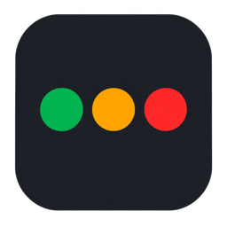
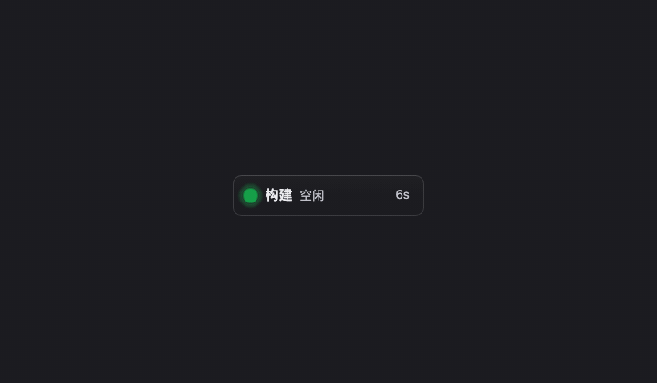
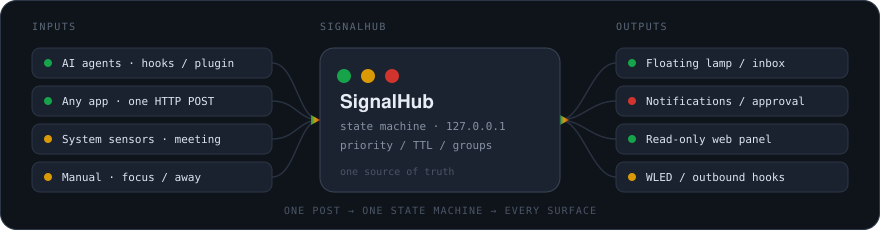

<div align="center">



<h1>SignalHub</h1>

<p><strong>One small lamp for your desktop — see what every agent is doing at a glance.</strong></p>

<p><sub><a href="README.md">中文</a> · <strong>English</strong> &nbsp;·&nbsp; macOS / Windows / Linux</sub></p>

<p>
  
  
  
</p>

</div>

<p align="center">
  
</p>

<p align="center"><sub>All ten states in one loop. Folding, approvals, the radial menu, inbox and messages: see the <a href="docs/scenes.md">eight scene animations</a>.</sub></p>

## What it is

A lamp that lives on your desktop. What you and your agents are doing right now is written in colour and blink rhythm — no switching back to the terminal.

- **One setup, ten agents**: Claude Code / CSC / Codex / Cursor / Gemini CLI / Goose / opencode / Pi / Hermes / WorkBuddy — one command installs the hook, then restart the agent.
- **Not tied to agents**: any program that can send one HTTP request can report a state.
- **State stays local**: it only listens on `127.0.0.1` by default. LAN access, the web panel and forwarding are all off until you turn them on.

## 30-second start

```bash
signalhub install hooks claude-code   # wire up an agent, then restart it
signalhub working --session demo      # or just report a state yourself
```

After that: a prompt → fast green, a tool call → slow green, approval needed → red, answer → a pulse and back to steady. See [Wiring up an agent](#wiring-up-an-agent).

### One report, every surface



One HTTP POST goes into **one state machine** and fans out to the floating lamp, inbox, system notifications, a read-only web panel, phone push, a WLED light and multi-machine aggregation. Inputs can be hooks, any program, system collectors or even the tray's "focus for 25 minutes" — they all take the same path, so stats, history and forwarding recognise them without a second state machine. See [Reporting state](#reporting-state).

## States at a glance

| State | Looks like | Means |
|---|---|---|
| `idle` | green, steady | Idle, nothing to do |
| `thinking` | green, fast blink | Reasoning |
| `working` | green, slow blink | Running a tool / task |
| `done` | green, steady + a pulse | Finished (disappears after 3 min by default; configurable) |
| `attention` | amber, blinking | Wants your attention |
| `permission` | red, smooth blink | Waiting for approval |
| `error` | red, hard strobe | Error / blocked |
| `stale` | grey, steady | There is a session, but it stopped talking |
| `offline` | grey, dimmer | No sessions at all |
| `off` | grey, dimmer | Monitoring is paused |

Priority is **red > amber > green**: while one group waits for approval, another reporting "working" will not override the red. The global state is the highest across all groups.

Three channels that do not rely on colour: permission and error dots are **rounded squares**, the rest circles; `stale` carries a thin **ring** that shortens as its grace period runs out; and **quiet mode** (on by default) fades idle / stale / offline signs to almost nothing until something needs you.

## What it can do

**The lamp** — one dark rounded sign per group, the most urgent first. When several need you they get louder and the rest step back; signs that are working breathe in a staggered rhythm. Click to fold between a stack and a single light (vertical or horizontal, with optional group name / number / state, and a state-tinted `+N` for the overflow); long-press for the radial menu; drag to move it and it remembers; right-click a sign to hide, mute, set aside for 15 minutes, clear, or read why it looks the way it does at the top of the menu.

**Make it yours** — six dot shapes, four sign outlines, five skins, six independent light slots (a tick above and below each row plus four marks at the row's end, each with its own drawing style and one of nine triggers), five effects, and a visible-sign limit (6 by default, 4–8; overflow folds into `+N`). Colour, shape and rhythm can also be overridden per state. Settings → Lamp.

**Inbox & approvals** — long-press the lamp or `⌃⌥I` to open, ordered "needs you → running → just finished → idle": allow / deny, jump to the terminal tab, mute, clear, or "tell me when it's done", plus a one-line summary when you return after 10+ minutes away. "Approve from the lamp" moves Claude Code's confirmation onto the lamp (**off by default**); dangerous commands need an 800 ms hold, truncated ones can only be denied, and it **never answers "Allow" on your behalf**.

**Notifications** — fired when a state newly becomes "needs permission / attention / error", only on the transition and only after it persists 5 seconds (both configurable). Mute per group, set quiet hours, add a sound; clicking the notice opens the project folder. Three presets: re-push to your phone after an approval sticks for 60 s, hold notices while an agent is working, and turn the meeting sign blue and silent during a call.

**Presentation mode** — `⌥⌘P` fills the screen under the cursor with a large board: one matching lamp dot per group beside its name, state and duration, readable from three metres away. It only draws what the lamp already knows (no command text or messages), so projecting it is redaction by construction. Off by default, never automatic, no sleep prevention; `Esc` or the tray exits. Mutually exclusive with click-through.

**Session management** — the "Sessions" tab in the left rail lists every session by group: copy the ID, open the working directory, clear one or clear all. The per-group display settings (rename / pin / hide / mute) live there too.

**You are a signal source too** — the tray's "Manual state" has focus-for-25-minutes, in-a-meeting and away. They are just an ordinary group, so stats, history and forwarding pick them up automatically.

**Six shortcuts** — `⌃⌥I` inbox · `⌃⌥L` show / hide lamp · `⌃⌥M` mute the worst group · `⌃⌥0` clear the worst group · `⌃⌥S` click-through · `⌥⌘P` presentation mode. On Windows / Linux: `Ctrl+Alt+I / L / M / 0 / S` and `Ctrl+Alt+P`. Any that could not be registered is flagged in settings.

**Forwarding & remote** — outbound hooks POST state to ntfy / Slack / your own endpoint or run a local command; a read-only web panel gives you a tokenised link to view the lamp in a phone browser (off by default); a WLED light receives only the state colour; multi-machine mode pulls other machines' boards into the same lamp, with no upgrade needed on the remote side.

**Call Me** — the reverse channel: put a link in an article, and agents that read it leave you a note through **your own server**, which the app pulls into Settings → Workspace → Messages.

**Look before you install** — Settings → Demo plays scripted scenes with the real lamp / inbox / ring components, touching no real state; `?window=demo` in a browser is the same thing as a standalone page.

> This is the overview. Design trade-offs, limits and bugs actually hit live in the [architecture docs](docs/architecture.md); the per-release change records are in its §3.35 subsections.

## Docs map

| Want to… | Go to |
|---|---|
| Download, or run from source | [Installing](#installing) · [Running from source](#running-from-source) |
| Report state over HTTP / CLI | [Reporting state](#reporting-state) |
| Connect a specific agent | [Wiring up an agent](#wiring-up-an-agent) |
| Combine several machines | [Multiple machines](#multiple-machines--teams) |
| Deploy the message server | [Call Me](#call-me) |
| Watch real operation clips | [Eight scenes](docs/scenes.md) |
| Full API reference | [API docs](docs/api.md) |
| Design trade-offs | [Architecture](docs/architecture.md) |
| Call Me deploy / troubleshooting | [Call Me docs](docs/callme.md) |
| Pending work & known limits | [backlog](docs/backlog.md) |

## Installing

Grab a build from [Releases](https://github.com/iFishin/SignalHub/releases):

- **macOS** — the `.dmg`; drag it into Applications. `aarch64` on Apple Silicon, `x64` on Intel.
- **Windows** — the `-setup.exe` (NSIS installer) or the `_x64_portable.zip` (unzip and run). On first launch the portable build registers a per-user Start-menu shortcut and one `HKCU` key so Windows toasts can be delivered; no installer and no admin rights are involved (see [architecture §3.30](docs/architecture.md)). If notifications stay silent, check whether the state at the top of Settings → Notifications → Alerts says "Not registered".
- **Linux (beta)** — the `.AppImage` or the `.deb`. Transparency and always-on-top may not work under Wayland; if so, start with `GDK_BACKEND=x11`. Without FUSE, use `--appimage-extract-and-run`.

**The builds are unsigned**, so the first launch is blocked once. On macOS, run:

```bash
xattr -dr com.apple.quarantine /Applications/SignalHub.app
```

That clears the quarantine flag recursively for the whole bundle — both the app and the bundled `signalhub` command. (Right-clicking the icon → Open → Open also works, but may not cover the inner command.) On Windows, click "More info" → "Run anyway" in SmartScreen.

The `signalhub` command **ships inside the app** — no separate install. To use it in a terminal, add it to your PATH:

```bash
ln -sfn /Applications/SignalHub.app/Contents/MacOS/signalhub /usr/local/bin/signalhub
```

**Updating:** macOS has in-app updates since 0.2.4 (Settings → System → Updates & diagnostics; nothing installs until you click). Linux and Windows are manual downloads for now — the unpacking library Windows needs was pulled upstream, and the Linux path has not been verified on real hardware (see [.github/release-body.md](.github/release-body.md)). Pushing a `v` tag builds all four platforms — see [release.yml](.github/workflows/release.yml).

## Running from source

You need Node.js and a Rust toolchain. On Linux, first install the system libraries listed in the "install Linux system dependencies" step of `.github/workflows/release.yml`.

```bash
npm install
npm run tauri dev
```

**Run `npm run stage-cli` before `cargo test`.** The CLI ships as a sidecar, and `tauri-build` checks that the file exists at **build-script time** — without it, even `cargo test` fails to compile. `tauri dev` / `tauri build` do this for you; only direct `cargo` invocations need it (and again after `cargo clean`).

**If you see `failed to read file 'capabilities/._default.json': stream did not contain valid UTF-8`**, delete the `._*` files under `src-tauri/capabilities/` and rerun. On exFAT / NTFS external volumes macOS writes an AppleDouble metadata file next to every file it touches, and `tauri-build` reads **every** file in the capabilities directory as UTF-8. Those files are in `.gitignore`; deleting them costs nothing. On such a volume, also point `CARGO_TARGET_DIR` at APFS (see `.cargo/config.toml`).

On first launch it creates `port` and `token` under `~/.signalhub/` (`%USERPROFILE%\.signalhub` on Windows). The window is borderless, is not in the taskbar or Dock — **quit it from the tray icon**.

## Reporting state

HTTP API (defaults to `127.0.0.1:41320`; the real port is in `~/.signalhub/port`). **It only listens on this machine by default**:

```bash
curl -s -X POST "http://127.0.0.1:$(cat ~/.signalhub/port)/v1/state" \
  -H "Authorization: Bearer $(cat ~/.signalhub/token)" \
  -H 'Content-Type: application/json' \
  -d '{"state":"permission","session":"demo","message":"needs approval"}'
```

On Windows with PowerShell:

```powershell
$dir = "$env:USERPROFILE\.signalhub"
$port = Get-Content "$dir\port"
$token = Get-Content "$dir\token"
Invoke-RestMethod -Method Post "http://127.0.0.1:$port/v1/state" `
  -Headers @{ Authorization = "Bearer $token" } `
  -ContentType 'application/json' `
  -Body '{"state":"permission","session":"demo","message":"needs approval"}'
```

**Reporting from another machine**: turn on "Allow LAN access" in Settings → Connect (off by default). The server binds `0.0.0.0` and machines / containers / WSL on the same network can reach it — at the cost that **anyone on that network with the token can report**, so do not use it on public WiFi. It takes effect after restarting the app.

Or use the CLI:

```bash
signalhub working --session build-1 --agent ci --message "compiling"
signalhub status
signalhub watch                                   # follow state changes in a terminal
signalhub watch --until done --timeout 10m        # wait for a state in CI
```

Full API reference: [docs/api.md](docs/api.md).

## Wiring up an agent

```bash
signalhub install hooks claude-code      # also: csc / codex / cursor / gemini / goose / workbuddy / opencode / pi / hermes
signalhub install hooks claude-code --dry-run   # see what it would change first
```

It touches **only the `hooks` key** of the agent's config, keeps everything else byte for byte, and backs the file up to `*.signalhub-backup` first. Running it twice does not duplicate entries; if the command changed it updates in place; invalid JSON aborts. Undo with `signalhub uninstall hooks claude-code`. Goose / opencode / Pi / Hermes use a plugin mechanism (a directory or file of our own) and never touch shared config.

Restart the agent afterwards. Per-agent differences are in [docs/api.md §4](docs/api.md).

**An agent that is not on the list**: most are Claude Code clones, so register one with a single command:

```bash
signalhub add-agent --id my-agent --name "My Agent" \
  --family claude-code --config ".my-agent/settings.json" \
  --marker ".my-agent" --command my-agent
signalhub install hooks my-agent
```

Validation, preserving existing entries and atomic writes are handled by the command. Or use "Copy setup prompt" under Settings → Connect → Custom agents and let the agent configure itself. Field table: [docs/api.md §4.18](docs/api.md).

Put the CLI on your PATH first so the config gets a portable bare name: on macOS / Linux `ln -sfn "$(pwd)/src-tauri/target/debug/signalhub" ~/.local/bin/signalhub`; on Windows append `src-tauri\target\debug` to your user PATH and reopen the terminal. An absolute path works too, but once you move the binary the hooks silently stop working.

## Multiple machines / teams

Make one machine a hub, and its lamp shows every machine:

```
mac-mini · ci           waiting for approval
server · build          working · running npm test
default                 idle
```

Two steps, both on the **hub**: ① on the **remote**, turn on Settings → Connect → Allow LAN access; ② in the hub's Settings → Multiple machines, add an entry (name, remote address, remote token) and click "Test connection". The remote needs no upgrade — the hub pulls `GET /v1/state`, available since 0.1.

Remote sessions join aggregation, the inbox and stats like local ones, but are read-only (no approving, no terminal jump); a remote drops to grey after 6 s and adds a "can't connect" sign after 3 failures. Direct connections only (LAN / VPN / tunnel), no relay. Rationale: [architecture §3.26](docs/architecture.md).

## Call Me

The lamp answers "what are my agents doing". **Call Me runs the other way**: put a link in an article, and agents that read it leave you a note through **a server you host yourself**, pulled into Settings → Workspace → Messages.

```
external agent ──POST /c/<token>──▶ signalhub-callme (your server, one Docker command)
desktop app ──polls every 15s──▶ message list (read / unread, filter by link, open source)
```

- **One link per place**: the token lives in the URL, so the source cannot be forged; each link can be renamed, revoked, deleted or rate-limited on its own.
- **Abuse control**: 10 posts per IP per hour, 50 per link per 24 h, 4000 characters each; anything with a browser `Origin` header is refused.
- **Try it first**: Settings → Connections → Call Me → Server → Start runs the same server on `127.0.0.1:43877`, loopback only, stopping with the app.
- The server is a separate crate (`server/`) that does not link Tauri, so it runs on a bare VPS / container; TLS is left to a reverse proxy.

```bash
docker build -t signalhub-callme ./server
docker run -d -p 8080:8080 -e CALLME_ADMIN_TOKEN="$(openssl rand -hex 24)" \
  -v callme-data:/data signalhub-callme
```

Deployment: [docs/callme.md](docs/callme.md). API: [docs/api.md §9](docs/api.md).

## Status

Done: the floating lamp, aggregation and TTL, the HTTP API and CLI, settings, one-click setup for ten agents, notifications, approvals, presentation mode, multiple machines, the phone panel, forwarding, WLED, Call Me, stats and history, session management — see the per-release records in §3.35 of the [architecture docs](docs/architecture.md).

To do: code signing and notarization (the steps have a place reserved in [release.yml](.github/workflows/release.yml) — fill them in once you have certificates). Full pending work, unverified items and known limits: [docs/backlog.md](docs/backlog.md). macOS has in-app updates (manual trigger); Linux and Windows do not — the reasoning lives in [update.rs](src-tauri/src/update.rs).

## License

MIT — see [LICENSE](LICENSE).
