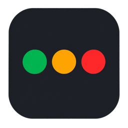
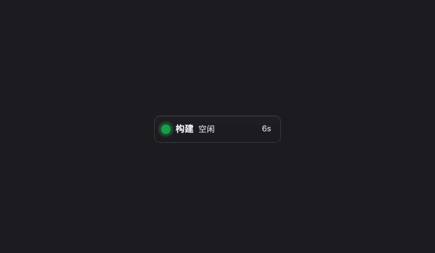
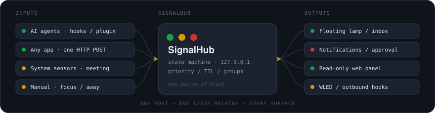

<div align="center">



<h1>SignalHub</h1>

<p><strong>One small lamp for your desktop — see what every agent is doing at a glance.</strong></p>

<p><sub><a href="README.md">中文</a> · <strong>English</strong> &nbsp;·&nbsp; macOS / Windows / Linux</sub></p>

<p>
  
  
  
</p>

</div>



<sub>This is not a screen recording. Colours and blink timings are taken straight from <a href="src/styles/state.css"><code>state.css</code></a> / <a href="src/styles/lamp.css"><code>lamp.css</code></a> (green <code>#16a34a</code>, red <code>#d0342c</code>, 640 / 1600 / 900 ms), down to the rounded-square <code>permission</code> dot, the dimmed quiet-mode sign and the 800 ms hold on a destructive approval. Re-render with <a href="scripts/render-demo.sh"><code>sh scripts/render-demo.sh</code></a> when the defaults change.</sub>

## What it is

A cross-platform floating status light for your desktop. A stack of always-on-top, draggable transparent signs that show the current state with colour and rhythm; click to collapse into a vertical column of lights (horizontal is optional; each light can carry a group name, number or state), long-press for a radial menu that opens the inbox.

Built for AI coding agents first: **Claude Code, Codex, Cursor, Gemini CLI, Goose, WorkBuddy, opencode, Pi and Hermes all connect in one click** (most get hooks written into their own config files; opencode, Pi and Hermes get a plugin file). But it is **not tied to them** — any program that can send one HTTP request can report its state.

```bash
signalhub install hooks claude-code   # wire up an agent, then restart it
signalhub working --session demo     # or just report a state yourself
```

### One report, every surface



**One HTTP POST goes into one state machine and fans out to every output**: the floating lamp, inbox, system notifications, a read-only web panel, phone push, a WLED light, and multi-machine aggregation. Inputs can be agent hooks, any program, system collectors or even the tray's "focus for 25 minutes" — they all take the same path, so stats, history and forwarding recognise them without a second state machine. See [Reporting state](#reporting-state) for the API.

> The design docs in [`docs/`](docs/) are written in Chinese. They are maintainer documentation: they record *why* each decision was made and which bugs were actually hit. This README and the app UI are available in English.

## States

| State | Looks like | Means |
|---|---|---|
| `idle` | green, steady | Idle, nothing to do |
| `thinking` | green, fast blink | Reasoning |
| `working` | green, slow blink | Running a tool / task |
| `done` | green, steady + a pulse | Finished (disappears after 3 min by default; configurable) |
| `attention` | amber, blinking | Wants your attention |
| `permission` | red, smooth blink | Waiting for approval |
| `error` | red, hard strobe | Error / blocked |
| `stale` | grey, steady | There is a session, but it stopped talking |
| `offline` | grey, dimmer | No sessions at all |
| `off` | grey, dimmer | Monitoring is paused |

Priority is **red > amber > green**: while one group is waiting for approval, another group reporting "working" will not override the red; and when the waiting group goes back to work, the red clears on its own. The global state is the highest priority across all groups.

**Each sign** is a dark rounded pill (the same visual language as the app icon): a coloured dot, the group name, the state, and how long it has been that way — plus a second line when there is a message. **When there is more than one sign, the ones that want you are louder** — on approval, attention and error the dot is larger and the pill stays solid; everything else (working, done, idle…) steps back one level, so your peripheral vision can tell which one to look at first. With a single sign there is no such split: there is nothing to compare against, so dimming it would only make the whole lamp recede. State words on the lamp are the short form ("Approve", "Work", "Done"), which leaves the width to the group name.

**Grouping** is decided by the reporter — pass an optional `group` (the `group` field in the HTTP body, or `--group` on the command line):

```bash
curl -s -X POST ... -d '{"state":"working","session":"a","group":"work"}'
curl -s -X POST ... -d '{"state":"error","session":"b","group":"ci"}'

signalhub working --session a --group work
signalhub error --session b --group ci
```

You then get two signs on the lamp (the most urgent one first), and the global state is the highest of the two. Omit `group` and it goes to `default`, which behaves exactly like a single-group setup. The hook commands we install carry no `--group`, so every agent you connect today still lands in `default` — grouping is for when you explicitly want more than one.

**A reporter can also declare what kind of source it is** (`--source agent|system|custom`; otherwise it is inferred from the name): the Connect page uses it to split everything that is not a known agent into **System** and **Custom**, so a script watching the machine does not get mixed up with your own small tools. `signalhub hook` reports `agent`; commands wrapped by `signalhub run`, and a hand-written `signalhub working`, land in `custom`; `--source system` puts you in the system group (the built-in Meeting and Backup collectors report as it). It only affects how the Connect page groups things — aggregation, grouping, TTL and notifications are unaffected, so getting it wrong, or leaving it out, changes nothing about the lamp.

**The machine's own state can be a signal source too.** The Connect page's **System sources** section holds two built-in collectors, **both off by default**: **In a meeting** (the microphone or camera is in use by any app → a "Meeting" sign appears, and it reports "Meeting ended" afterwards) and **Time Machine backups** (`tmutil status` → a "Backup" sign, reporting "Backup finished" once done). They read system state every 5 seconds — **only whether a device is in use or a backup is running; they never capture or store any audio, video or file contents**, and reading this state does not trigger microphone or camera permission prompts. If a collector thread errors it writes a single log line and lets its sign expire via the 15-second TTL, so no false state is left behind. Both exist on macOS only; on other platforms the section simply does not list them.

If you would rather not type `group` every time, Settings → Connect has a **Group by working directory** switch: turn it on and reports that carry no `group` are grouped by their `cwd` instead — one directory per sign, one project per row. A report that does carry a `group` still wins, so the two can be mixed. The group name is that path; rename it under Groups → Per-group display if it is too long (or right-click that sign and pick **Rename…**, which jumps straight to that page). It is **off by default**, so upgrading never makes anyone's lamp sprout extra signs.

**Each group's label and position are yours to set** (Settings → Groups → Per-group display): a group name is an identifier the reporter chose (`build-1`), and you can rename it to something readable, or **pin** it so it always sits first on the lamp. Unpinned groups still sort by urgency, so a red one can never be pushed below a green one. Both are display-only: the group names in the API, and hide/mute matching, are unaffected. **Renaming has exactly one entry point** — before 0.6.2 you could click the name right on the sign to edit it in place; that is gone, because the lamp's job is to be read at a glance, and an invisible input box on the label means a drag or a right-click can land you in an edit state instead.

**The Groups page also decides how many lamps there are**: "One lamp" joins every group into a single board; "One per group" gives each group its own draggable lamp and leaves the main lamp showing global state. New lamps appear along the right edge and each remembers where you drag it (more than 8 groups falls back to a single lamp). When they end up scattered, use Settings → Groups → **Lamp positions / Reset positions**, or **Reset lamp positions** in the lamp's right-click menu: open group lamps return to the default column, every dragged position is forgotten, and the next new lamp joins the bottom of that column. Free dragging is unchanged — move them again whenever you like.

Three channels that do not rely on colour:

- **Shape**: by default `permission` and `error` are drawn as rounded squares, everything else as circles. Red/green is the hardest pair for colour blindness, and those are exactly the two states that most need your attention.
- **Thin ring**: a `stale` dot carries a thin ring that shortens as its grace period runs out, so you can see at a glance how long it has been quiet.
- **Brightness**: "quiet mode" is on by default — when idle, quiet or offline the whole sign fades to almost transparent, and only becomes fully visible when something is actually happening or needs you. Hover restores it. Can be turned off.

**Signs can also speak without words** (all off by default): each row carries **two short ticks** (top and bottom edges) and a **vertical stack of four tiny marks** at the row's right end — six independent slots in total. A tick is a square-ended short line whose four settings (off / tick / short / long) change only length and brightness — no gradients, no glow, no second outline; the four marks are squares, short lines and bars, and **circles belong to the main signal light alone**, so the left-hand dot no longer competes with them for shape or colour. Each mark can answer a yes/no question (empty / state colour / pinned / muted / about to go stale / click-through), and **each of the six rows stores its own trigger**: the top edge can stay on while the bottom lights only on an error, and no mark is tied to another. All six share one weight, one brightness and one colour; ticks and marks are absolutely positioned and **do not affect window size**. When several groups are active the rows share one outer frame and read as a single board, separated only by a 1px line instead of separate cards. A sign is only so wide and the text already runs to four lines — more content has to go into area and shape instead. When a condition does not hold that light **is not drawn at all** (it is not a dim dot), so "not lit" means "not the case". What it looks like lives under Settings → Lamp → Appearance, in the six rows of **Frame light** right below the live preview (always visible, never folded away); **when it lights up** is under Settings → Lamp → Behavior, with the same six rows picking from the **same nine conditions**: always, when you're needed, while active, follow quiet mode, in a chosen state, during chosen hours, silence nearly over, when a message is shown, only for pinned groups. Decisions are per row. **Click-through is one of the mark options** (a near-white bar); the old always-on ban badge in the window corner is gone, and the state is still in the tooltip, the tray menu and the notice you get when enabling it.

**Titles default to the session name only.** With session grouping the server label was "project · agent", but the sign has a fixed width and shares its first line with the status word, so `workbuddy` in `SignalHub · workbuddy` was nearly always cut off by the ellipsis. The default now shows just the project / session name; Settings → Lamp → Appearance → Basic lets you bring the agent back or write a template with `{session}`, `{agent}` and `{group}`. Per-group display names still win. Forwarded summaries and the web panel keep the full name — they are not width-constrained.

**Appearance is yours** (Settings → Lamp → Appearance): right under the live preview are **five skins** (Plain / Focus / Neon / Paper / Signal) — each swaps palette, card tint, radius and border, dot shape, card outline, motion, and the look and trigger of all six frame-light slots at once. Changing skins overwrites the six trigger rows too; for just size or opacity use the **four look presets** below (Single light / Compact / Standard / Bold). Individually you can also tune shape (expanded signs vs. folded lights), **fold direction** (vertical by default / horizontal), **folded content** (light only / group name / number / state — labelled lights share one narrow board of a fixed width per option, a third to nearly half narrower than the expanded sign; long names are ellipsized and readable on hover), size, **six dot shapes** (circle / rounded / ring / square / diamond / capsule), palette, background opacity, blink speed, **five effects** (off / breathing halo / pulse / sweep / fade), the texture layer (corner radius / border / sign tint / type scale / emphasis), **four card outlines** (rectangle / capsule / diagonal round / arch), the six **Frame light** rows plus weight / brightness / colour, the **Session title** setting (session name only / session · agent / custom template), sign typeface (system / monospace), sign gap, and which parts of the sign to show (dot / group name / state / duration / message). Outlines use `border-radius` only, so the edge ticks and end marks are never clipped.

**Every state can be styled individually** (Settings → Effects): colour, shape and rhythm can each be overridden per state; anything you leave alone follows the global defaults on the Appearance page. Four more presets (Follow global / Distinguish by shape / Rhythm by state / Blink only when needed) set the whole table at once.

**A system notification when something needs you**: fired when the state newly becomes "needs permission / needs attention / error", with the project name and the agent's own explanation. Those three are **a default, not a rule** — the Alert page has a row of state chips, so ticking "done" gets you a ping when the work finishes, and ticking nothing means no notifications at all (use the switch above to turn them off entirely). It only fires on the *transition*, not on every change — a single agent turn pushes state dozens of times, and a notification each time would just be noise. The state also has to **persist** (5 seconds by default, configurable), which filters out the `permission` prompts that come and go within a second. You can add a sound (works on macOS and Windows), **mute a group** (affects notifications and sound only — the lamp still shows it), and set a **quiet-hours window** (hourly granularity, handles crossing midnight; nothing fires or makes a sound during it, and nothing is delivered late — waking up to a pile of notifications from the night is exactly what quiet hours exist to prevent). There are also three **presets** (off by default, one switch each): push again through your phone-push hook when an approval has been stuck for 60 seconds; hold notifications while an agent is thinking or working; and turn the meeting sign blue and go silent while a call is on (with the "In a meeting" collector). They only decide *when to interrupt you* — there is no expression engine. Clicking the notification body itself opens the project folder, so you do not have to go find the project yourself; the two buttons are **Got it** (dismisses just this notification) and **Mute this group** (stops alerting for that group from now on).

**Or forward it somewhere else**: configure any number of outbound hooks in the Forwarding tab — on a state change, POST to a URL (ntfy, Slack, your own endpoint) or run a local command, each filtered to the states you care about. Common services have presets; for your own endpoint pick **Custom body** and write your own JSON with `{state}` / `{group}` / `{message}` placeholders. They run asynchronously with a timeout, so a dead target cannot affect anything locally. Format, placeholders and security notes: [docs/api.md §4.9](docs/api.md).

**And there is a light beyond the screen**: at the bottom of the Forwarding tab, enter a WLED address and the state colour is POSTed straight to it (`POST /json/state`) — a lamp next to your desk follows the state, so you can tell what is going on without looking at the screen. Only the colour is sent: no group names, no session names, no message text. Saving lights it up once with the current state — that is the answer to "does it work?" — and the result lands in the same log as the outbound hooks (`ok 200 success` means it does). Nothing is configured by default.

**Watch it from your phone**: turn on Settings → Connect → Read-only web panel and you get a link (token included, ready to copy) that shows the lamp in any phone or tablet browser — the state, what each group is doing, how long it has been that way. Read-only, nothing to install. It is **off by default**, and it shares the reporting service's listening address: only with "Allow LAN access" on can devices on the same WiFi see it (the settings page then warns you not to pass the link around, and not to leave it on over public WiFi).

**The inbox** (long-press the lamp for the radial menu, `⌃⌥I`, or the first tray item) lists every session under "Needs you → Running → Just finished → Idle". Pending approvals can be allowed or denied right there; every row can jump to its terminal tab (Terminal / iTerm2 / tmux — the first jump asks for Automation permission to control the terminal), mute the group, clear the session, or tap "**Notify me when done**" — you get one notice when that session finishes, fails or is cleared, without keeping an eye on the lamp (one-shot, removed after firing, not kept across restarts, and not suppressed by quiet hours since you explicitly asked for it; a remote session briefly dropping out of polling does not count as finished). **Coming back after more than 10 minutes** adds a one-line summary at the top, including sessions that finished and were already removed from the list. When nothing needs you it stays a quiet empty panel — with "Connect an agent" and "See the demo" right there, so a first run does not have to go hunting. **Click the lamp** to toggle between the stack of signs and a single light; the choice is remembered (Settings → Behavior can make that click open the inbox or do nothing). **Right-click a sign** to hide that group, mute it, clear its state, change the shape, or open settings. The lamp remembers where you dragged it. The History tab opens with today's cumulative time per state, and the Status tab has a 30-minute timeline where each segment's width *is* its duration. Each inbox row is just two lines: the project name and a right-aligned "waiting for" on top, machine / agent / folder / state as grey metadata below. Only allow / deny / jump stay visible; watch, mute and clear live behind a trailing `⋯` that expands on click — a row never grows on hover, so the "Allow" you were aiming at never moves — and `M` / `W` mute or watch the selected row directly. Both the inbox and settings windows can be resized (the lamp still has its size computed from content by Rust, so it stays fixed).

**Five global shortcuts** (listed in Settings → System → General, along with any that could not be registered): `⌃⌥I` opens the inbox, `⌃⌥L` shows / hides the lamp, `⌃⌥M` mutes / unmutes "the worst group", `⌃⌥0` clears the worst group, `⌃⌥S` toggles click-through. On Windows / Linux these are `Ctrl+Alt+I / L / M / 0 / S`. "The worst group" is the most urgent one — the same rule that puts a sign at the top of the lamp (pinning only changes the display order). Muting only affects notifications and sound; the lamp still shows that group, so the shortcut posts a notice saying what it did. They are deliberately **not configurable** — the real failure is another app already owning a combination, and making them configurable would not fix that — so any that could not be registered is flagged instead of becoming a key that does nothing. While click-through is on, that tray item reads "Exit click-through · ⌃⌥S" — the notification only fires once, the tray menu is the place you can always go back and check.

**You are a signal source too**: the tray menu's "Manual state" submenu has "Focus for 25 minutes" (a countdown appears on the lamp, ticking down once a minute, then notifying and turning `done`), "In a meeting", "Away" (two grey signs — half-transparent in quiet mode, which reads as "nothing is happening here" from across the room, with the line on the sign saying which one it is) and "Clear manual state". They are **just an ordinary group** (named "我" / "Me" to match the UI language), so stats, history, the read-only panel, outbound hooks and physical lights all pick them up — there is no second state machine. Meeting and Away occupy one sign and **do not touch notification settings**: use "Pause / resume monitoring" in the tray for "do not disturb me". This is also the cheapest proof that SignalHub is useful with no agents at all.

**Approve from the lamp** (Settings → Connect → Approve from the lamp, **off by default**): once on, every time Claude Code wants to ask you to approve a tool call, that confirmation box moves onto the lamp — a bubble appears, you click Allow or Deny, or you ignore it (after 45 seconds the question goes back to the terminal). **This is the only feature that changes how the agent behaves**, so it only acts at the moment the agent was going to ask anyway (`PermissionRequest`) and does not intercept other tool calls; it **never says "allow" on your behalf** (timeout, superseded, switch off, LAN access on — all of them say nothing and the question returns to the terminal); and **if it cannot be shown in full it cannot be allowed** — a command over 240 characters counts as truncated, and that one can only be denied or approved back in the terminal (a command you cannot read in full should not be one click away from running). The full command appears only in this local window; what gets reported is still the short phrase ("run npm"), and neither notifications nor outbound hooks carry it. The endpoint requires a token (the entry written into `~/.claude/settings.json` carries it), and uninstalling removes that token-bearing entry too. From the command line: `signalhub install hooks claude-code --approve` (then turn on the switch on the Connect page — that is the real gate).

**Claude Code with the HTTP install mode is the only supported agent today.** `install_approve`, the approve URL and the endpoint's path check all accept `claude-code` only, and the switch appears on that card alone. For every other agent — **WorkBuddy included** — a permission request still turns the lamp red and still fires a notification, but the confirmation stays in the agent's own window; go there to allow or deny. The desktop WorkBuddy build does not fire the `PermissionRequest` hook (it never appears in the local hook log; the red state comes from `Notification` with `notification_type: "permission_prompt"`), and its hooks reference does not document whether an HTTP hook can return a decision. We did not simply widen the allowlist: a switch that does nothing when you flip it is worse than no switch.

**Every state has a silence timeout** (`working` 600s, `attention` / `error` 300s, `thinking` / `permission` / `idle` 600s, `done` 180s; all configurable under Behavior → Silence timeouts or Look → Per-state overrides). What happens after it depends on whether that reporter **knows the agent's process**:

- **It does** (Claude Code's command hooks — on every platform, the opencode / Pi / Hermes plugins, `signalhub run`; Claude Code's optional HTTP hook mode carries no PID): if the process is still alive the session **keeps its last state** (a 20-minute build or ten minutes of reasoning produces no events, yet the lamp stays "working" / "thinking"; the agent's own end event decides when the turn is over); if the process is gone the session is removed immediately, without waiting for the timeout. **"Needs permission / attention / error" are not re-judged this way** — a live process does not prove the request was answered, so they still go stale.
- **It does not** (HTTP reporters, hand-written commands, the other hooks): the session turns `stale` (grey, steady) and is deleted 30 minutes later.

That way "the agent crashed / stopped talking" and "the agent is idle and waiting" look different, and you never get a lamp that keeps blinking for an agent that is long gone. **Hooks installed by an older version must be re-installed from the Connect page** to pick up the `$PPID` prefix (macOS / Linux only); until then they keep the old silence behaviour. No re-install is needed on Windows.

Liveness uses `kill(pid, 0)` on macOS / Linux and `OpenProcess` + `WaitForSingleObject` on Windows — both work. Windows command hooks used to have no PID; the CLI now walks its own parent-process chain to find the agent, skipping short-lived shells such as `cmd.exe`. If it cannot find one it reports **no** PID and falls back to the 30-minute grace, so a sign that should stay lit is never dropped by mistake. **The Windows parent-process chain has not been verified on real hardware yet** — the rules and their exclusions are documented at the top of `win_pid.rs`.

**The lamp does not immediately snap to "No agents reporting" when work finishes.** A `done` sign is deleted outright on expiry (it does not go `stale`), so at that moment the lamp would have nothing left to say but "No agents reporting" — exactly when you are asking yourself whether that last task actually finished. The lamp remembers the last completion: for ten minutes the empty state reads "**Just finished · 2 min ago**", and only after that does it fall back to "No agents reporting". That memory is display-only; it changes no state decision.

**See it before you install anything**: Settings → Demo plays five looping scenes — click a scene name to jump straight to it, each one loops on its own so you never wait through the others. **A day in the life** walks idle → thinking → working → waiting for approval → approved → done → an empty lamp that still remembers it just finished. **When it wants you** explains what amber means, how red and amber stack, and how an error differs from a pending approval at a glance. **When it goes quiet** covers the half-hour silence turning grey (which is not idle), the ring shape whose arc is the time left, and the “No agents reporting” line after a card drops. **Tucked away** shows quiet mode, collapsing the stack into one light, and how that light still flashes. **Speaking in light** walks the six independent slots: top and bottom edges picking their own looks (top only, both, both glowing), then the four corner lights on the outline — each answers one yes/no question (has a state / pinned / muted / about to go stale), and a corner whose condition does not hold is **not drawn at all**, so “not lit” means “not the case”. Two signs in different states then show the “only when you're needed” trigger, followed by **click-through** as one of the corner lights (drawn only while enabled) and a step where the top edge is “in a chosen state → error”, the bottom edge stays on, and so do the four corners — all six rows decide independently. The last step swaps in the **Neon skin**, changing palette, card shape, motion and all six slots at once. It renders the **real lamp component** against scripted data: no real state is touched, no notification is fired, nothing is written to history, and no agent is actually started. Pause, step and replay are all there. **On a first run with no groups at all**, the sign itself offers a small "See demo" button that jumps straight to that page; it folds itself away as soon as a real agent reports in. Opening `?window=demo` in a browser shows the same walkthrough as a standalone page (for README gifs and for people still deciding whether to install) — it is not a fourth Tauri window.

**Settings are easier to get around**: the left rail groups tabs under "what you're reading / lamp / notifications / connecting / help", with a search box matching tab names and Chinese/English aliases ("timeout", "ttl", "demo"). Connect, Call Me and System have one level of in-page sub-tabs, each page headed with what it does, and the last tab you were on is remembered. Focus rings, an active-tab indicator and a 140ms page transition are in place; the animation turns itself off when the OS asks for reduced motion.

**Check the state, then send a test notification**: Settings → Notifications → Alerts has a "Send a test notification" button. It goes through **the same outlet as a real alert** (including the sound, if enabled) and touches no state and writes nothing to stats. It reports the current notification permission afterwards — without permission the OS drops a notification silently, with no popup, no sound and no error, so "I clicked and nothing happened" cannot tell a missing permission from Focus mode or a broken build. **The app cannot see whether the OS actually displayed it** (the Windows plugin swallows the underlying error), so the result only means "handed to the OS". If you see nothing, check SignalHub under Notifications in System Settings and whether Focus is on; on Windows portable also make sure the state above is Granted rather than "Not registered" — the latter means the Start-menu shortcut native toasts require could not be created, and there is a Retry button next to it (see [architecture §3.30](docs/architecture.md)).

**One pre-release check instead of five pages**: "Run check" at the top of Settings → System walks through notification permission, the notification / sound / delay / quiet-hours / muted-group switches, whether installed hook commands still resolve, whether an install is stale after an upgrade, **how long ago an agent last reported**, whether "approve from lamp" matches a Claude Code HTTP install, custom preset parse errors, shortcut registration, the hook log and the active session count. Each line is flagged and the whole thing can be copied as a report. It reads data that already exists on the machine and **changes no settings** — far more useful in an issue than a screenshot.

**Come back and know what happened today**: Settings → History opens with a "Today at a glance" card — total recorded time, the state that took the most, time actually running, time waiting on you, approval counts and the longest wait, and how today compares with the daily average of previous days. Copy the whole thing as Markdown. It only adds up existing today / 7-day / approval data; idle and offline time is included, and approvals come from today's entries within the most recent 100 records. It measures **duration**, not individual sessions — sessions that came and went are covered by "This week in focus" below. Under-claiming beats making things up.

**Look back at the week by project**: right under "Today at a glance" sits the "**This week in focus**" card — how many sessions were active in the last 7 days, how many finished / failed, the busiest day, the project and agent that showed up most, the tool you denied most often, and total plus median approval wait. Only sums and maxima; the whole thing copies as Markdown.

Behind both cards is the same **event log**: `~/.signalhub/events/YYYY-MM-DD.jsonl`, one `start` / `change` / `end` per session, append-only, `0600`, kept for 30 days like the approval log. It is **not a second state machine** — every frame is diffed against the previous one at the single state-notification outlet (`notify::compose`), so HTTP reports, CLI, hooks, manual states, remote sessions and TTL expiry are all covered; it sits outside frame coalescing so intermediate states inside a 100 ms burst are not lost. Only "who became what when" plus a short clipped message go to disk, **never command text**. Each log is read up to 5000 entries (newest win); the UI says so, warns that the numbers may be low when the cap is hit, and reports "could not read" rather than "no records". Everything stays local, nothing is guessed.

## Installing

Grab a build from [Releases](https://github.com/iFishin/SignalHub/releases):

- **macOS** — the `.dmg`; drag SignalHub into Applications. Pick `aarch64` on Apple Silicon, `x64` on Intel.
- **Windows** — the `-setup.exe` (NSIS installer) or the `_x64_portable.zip` (unzip and run, no install). On first launch the portable build registers a per-user Start-menu shortcut and one `HKCU` key so Windows toasts can be delivered; no installer and no admin rights are involved (see [architecture §3.30](docs/architecture.md)). If notifications stay silent, check whether the state at the top of Settings → Notifications → Alerts says "Not registered".
- **Linux (beta)** — the `.AppImage` or the `.deb`. Transparency and always-on-top may not work under Wayland; if so, start it with `GDK_BACKEND=x11`. Without FUSE, use `--appimage-extract-and-run`.

**The builds are unsigned**, so the first launch is blocked once. On macOS, run this in a terminal:

```bash
xattr -dr com.apple.quarantine /Applications/SignalHub.app
```

That clears the quarantine flag recursively for the whole bundle — both the app and the `signalhub` command bundled inside it. (Right-clicking the icon → Open → Open also works, but may not cover that inner command.) On Windows, click "More info" → "Run anyway" in SmartScreen.

The `signalhub` command **ships inside the app** — no separate install. The one-click setup under Settings → Connect uses it. To use it in a terminal, put it on your PATH:

```bash
ln -sfn /Applications/SignalHub.app/Contents/MacOS/signalhub /usr/local/bin/signalhub
```

**Updating:** macOS has in-app updates since 0.2.4 (Settings → System → Updates & diagnostics shows whether there is a newer version; nothing installs until you click it). Linux and Windows are manual downloads for now — the unpacking library Windows needs was pulled upstream, and the Linux path has not been verified on real hardware (the reasoning lives in [.github/release-body.md](.github/release-body.md)).

Pushing a tag starting with `v` builds every platform's packages automatically (two macOS builds, Windows NSIS plus the portable zip, Linux deb + AppImage) — see [.github/workflows/release.yml](.github/workflows/release.yml).

## Running from source

You need Node.js and a Rust toolchain.

```bash
npm install
npm run tauri dev
```

**Run `npm run stage-cli` before `cargo test`.** The CLI ships as a sidecar inside the app bundle (see `externalBin` in [tauri.conf.json](src-tauri/tauri.conf.json)), and `tauri-build` checks that the file exists at **build-script time** — without it, even `cargo test` fails to compile. `tauri dev` / `tauri build` run that step for you; only direct `cargo` invocations need it (and again after `cargo clean`).

**If you see `failed to read file 'capabilities/._default.json': stream did not contain valid UTF-8`**, delete the `._*` files under `src-tauri/capabilities/` and rerun. When the repo lives on an exFAT / NTFS external volume, macOS writes an AppleDouble metadata file next to every file it touches, and `tauri-build` reads **every** file in the capabilities directory as UTF-8. Those files are already in `.gitignore`, so deleting them costs nothing; on such a volume also point `CARGO_TARGET_DIR` at an APFS disk (see the note in `.cargo/config.toml`).

On first launch it creates `port` and `token` under `~/.signalhub/` (`%USERPROFILE%\.signalhub` on Windows). The window is borderless, is not in the taskbar and does not take a Dock icon — **quit it from the tray icon**.

## Reporting state

HTTP API (defaults to `127.0.0.1:41320`; the real port is in `~/.signalhub/port`). **It only listens on this machine by default** — other machines cannot reach it, and that is its default security boundary:

```bash
curl -s -X POST "http://127.0.0.1:$(cat ~/.signalhub/port)/v1/state" \
  -H "Authorization: Bearer $(cat ~/.signalhub/token)" \
  -H 'Content-Type: application/json' \
  -d '{"state":"permission","session":"demo","message":"needs approval"}'
```

There is no `$(cat …)` on Windows; the PowerShell equivalent:

```powershell
$dir = "$env:USERPROFILE\.signalhub"
$port = Get-Content "$dir\port"
$token = Get-Content "$dir\token"
Invoke-RestMethod -Method Post "http://127.0.0.1:$port/v1/state" `
  -Headers @{ Authorization = "Bearer $token" } `
  -ContentType 'application/json' `
  -Body '{"state":"permission","session":"demo","message":"needs approval"}'
```

**Reporting from another machine**: Settings → Connect has an **Allow LAN access** switch (off by default). Turned on, the server binds `0.0.0.0` and machines, containers or WSL on the same network can reach it — at the cost that **anyone on that network who has the token can report**, so do not turn it on over public WiFi. It takes effect after restarting the app.

Or use the CLI:

```bash
signalhub working --session build-1 --agent ci --message "compiling"
signalhub status
signalhub watch                                   # follow state changes in a terminal
signalhub watch --until done --timeout 10m        # wait for a state in CI
```

Full API reference: [docs/api.md](docs/api.md).

## Wiring up an agent

```bash
signalhub install hooks claude-code      # also: csc / codex / cursor / gemini / goose / workbuddy / opencode / pi / hermes
signalhub install hooks claude-code --dry-run   # see what it would change first
```

It writes hooks into the agent's config file (`~/.claude/settings.json` for Claude Code). It touches **only the `hooks` key**, keeps everything else byte for byte, and backs the file up to `*.signalhub-backup` first. Running it twice does not duplicate entries; if the command changed it updates in place; and if the file is not valid JSON it aborts without writing anything. Undo with `signalhub uninstall hooks claude-code`.

**Goose, opencode, Pi and Hermes are the exception**: they use a plugin mechanism, so SignalHub installs a directory or file of its own (Goose: `~/.agents/plugins/signalhub/`, Pi: `~/.pi/agent/extensions/signalhub.ts`) and never touches your shared config — uninstalling removes the whole thing. The others insert an entry into a shared config file.

Restart the agent afterwards. Then: prompt → fast green, tool call → slow green, permission → red, answer → a pulse and back to steady. Per-agent differences (which ones have no "needs permission" event, whose payload field names differ) are in [docs/api.md §4](docs/api.md).

**An agent that is not on the list does not have to wait for a release.** Most of the long tail are Claude Code clones — same event names, same fields, same entry shape, only the config path and the name differ. Register one with a single command instead of hand-writing JSON:

```bash
signalhub add-agent --id my-agent --name "My Agent" \
  --family claude-code --config ".my-agent/settings.json" \
  --marker ".my-agent" --command my-agent
signalhub install hooks my-agent
```

`add-agent` validates the fields, **preserves** every existing entry and unknown key in `~/.signalhub/agents.json`, writes atomically, and is idempotent. It refuses (with a reason) a `--config` pointing into SignalHub's data directory, an id colliding with a built-in, or a family outside the whitelist. The preset then shows up in the Connect page next to the ten built-ins, and install / uninstall / detection all work the same way. Hand-writing the JSON is still a second route (field table and example: [docs/api.md §4.18](docs/api.md)). If the event names genuinely differ, that still needs code; `signalhub run` is the stopgap there.

**Do not want to work that out yourself? Let the agent do it.** On Settings → Connect → Custom agents (and on the first-run Guide page) there is a **Copy setup prompt** button. Paste the whole prompt into the agent you are using and it will check whether the CLI is on PATH, work out whether it is already a built-in adapter, inspect its own hook config and event format, write a preset with `signalhub add-agent`, install the hooks and verify. If the format is incompatible it falls back to `signalhub run` or a direct report. **The write goes through a command rather than letting the model edit the config file**: validation, appending, idempotency and refusing to clobber a broken file are guaranteed by code, not by a paragraph of natural-language instructions. The prompt carries this machine's current adapter list, available families, config paths and port, comes in Chinese or English to match the UI language, and explicitly asks the agent to list candidates rather than guess when `family` is uncertain.

Put the CLI on your PATH first, so what gets written into the config is the portable bare name rather than an absolute path:

```bash
ln -sfn "$(pwd)/src-tauri/target/debug/signalhub" ~/.local/bin/signalhub
signalhub install hooks claude-code
```

On Windows there is no symlink step — append `src-tauri\target\debug` (that is where `signalhub.exe` lives) to your **user** PATH and open a new terminal:

```powershell
$user = [Environment]::GetEnvironmentVariable('Path', 'User')
[Environment]::SetEnvironmentVariable('Path',
  "$user;$(Resolve-Path src-tauri\target\debug)", 'User')
```

An absolute path works too, but the moment you move the binary the hooks silently stop working (nothing shows up in the agent's session) and that is a painful thing to track down.

## Call Me

The lamp answers "what are my agents doing". **Call Me runs the other way**: you put a link in an article or page, and any AI agent that reads it can leave you a note through **a server you host yourself**. The desktop app pulls those notes in and shows them under Settings → Workspace → Messages, with an "open source" button so you can go fix the thing they commented on.

```
external agent ──POST /c/<token>──▶ signalhub-callme (your server, one Docker command)
desktop app ──polls every 15s──▶ message list (read / unread, filter by link, open source)
```

- **One link per place**: the token lives in the URL, so the server knows which article a note came from; each link can be renamed, revoked, deleted or rate-limited on its own, and the source cannot be forged.
- **Abuse control**: 10 posts per IP per hour, 50 per link per 24h, 4000 characters per message; anything carrying a browser `Origin` header is refused. When the quota runs out or you stop wanting notes, revoke the link (reversible) or delete it for good (frees the slot); messages already received are kept either way.
- **Not the inbox**: the inbox answers "which agent is stuck, and should I approve it"; notes are text to read. Mixing them would drown the "needs you" section.
- **Try it before you deploy**: Settings → Connections → Call Me → Server → Start runs the same server on `127.0.0.1:43877` and fills the address and token back into the settings; it stops with the app. It only listens on loopback, so it is for posting a test note yourself — outside agents still need the VPS deployment. The first start also creates the first link for you.
- **Zero config**: creating a link needs no name or location; the first note fills both in. Opening the link with GET returns a short usage guide for agents (method, fields, limits), so the article only needs that one short URL — no instructions pasted alongside it.
- The server is a separate crate in this repo (`server/`) and **does not link Tauri**, so it runs on a bare VPS / container; TLS is left to a Caddy / nginx reverse proxy.

```bash
docker build -t signalhub-callme ./server
docker run -d -p 8080:8080 -e CALLME_ADMIN_TOKEN="$(openssl rand -hex 24)" \
  -v callme-data:/data signalhub-callme
```

Deployment details (proxy, backups, troubleshooting) in [docs/callme.md](docs/callme.md), the HTTP contract in [docs/api.md](docs/api.md) §9, and the design rationale in [docs/architecture.md](docs/architecture.md) §3.27.

## Status

Done: the floating lamp, state aggregation and TTL, the HTTP reporting API, the CLI (including `watch`), the settings panel, automatic hook installation (Claude Code / Codex / Cursor / Gemini CLI / Goose / opencode / Pi / Hermes), the connect self-check (the Connect page checks whether the command it installed still runs — that kind of failure is silent), the hook call log (the tail is right there under System → Data), `signalhub run` (wraps any command and reports for it), the "what it's doing" line on the sign (generated from tool events, so you do not configure a sentence per agent), CLI text that follows the UI language (`--help`, errors and command output all have Chinese and English), system notifications with sound and action buttons, window position memory, the expanded/collapsed shapes, per-group right-click menus, today's duration stats, a 30-minute timeline and a 7-day history page, outbound hooks, per-state colour / shape / rhythm, per-group mute, quiet hours, a persistence threshold before alerting, repeat reminders while something stays stuck (again at 5 / 15 / 30 minutes, saying how long it has been waiting), a tray icon that follows the state, single-instance, launch at login, global shortcuts (open the inbox, show/hide the lamp, mute the worst group, clear the worst group, click-through — one that could not be registered is flagged in settings), an inbox with one row per session (needs you / running / just finished / idle, with allow / deny / jump / mute / clear), and jumping to the exact terminal tab (Terminal / iTerm2 / tmux; macOS only, with app activation and project-folder fallbacks), manual states (focus 25 minutes / in a meeting / away — you are a signal source too), grouping (an explicit `group` or `--group`, or an automatic fallback per working directory or per session — one sign per session), per-day stats persisted to disk (kept for 30 days), configuration export / import, an opt-in LAN access switch (off by default), click-through mode, source kinds on the Connect page (AI agents / system / custom, declared with `--source`), a read-only web panel (open a link on your phone to watch the lamp; off by default), physical lights (WLED — the state colour is POSTed to the light, colour only, nothing configured by default), approve from the lamp (when Claude Code asks you to approve a tool call, the confirmation box moves onto the lamp — off by default, and a command you cannot read in full cannot be allowed), and presets (push a stuck approval to your phone after 60 seconds / hold notifications while an agent is working / blue lamp and silence during a meeting — off by default, presets only, no expression engine), a demo mode (Settings → Demo plays a 30-second scripted walkthrough on the real lamp without touching real state; a first-run lamp offers a "See demo" button; `?window=demo` is a standalone browser page), settings tab search / in-page sub-tabs / last-tab memory, keyboard focus rings and page transitions, a one-click test notification (Alerts, uses the real alert outlet and reports permission), a system check (System → Updates & diagnostics, a dozen checks with a copyable report), and a daily digest card (History, pure-function summary of today / 7-day / approval data, copyable), an event log (daily jsonl, 30 days, `start` / `change` / `end` diffed at the single state-notification outlet), the away-summary v2 (sessions that finished and vanished are now visible), a "This week in focus" card (last 7 days grouped by project / agent / tool), and "Notify me when done" (one-shot per-session subscription in the inbox), and Call Me (a self-hosted inbox: put a link in your writing, agents that read it leave notes, the desktop app pulls them in — one revocable link per place, with per-IP and per-link rate limits; messages have their own "Overview → Messages" page, and you can start a loopback-only local server inside the app to try the flow first), and a settings panel regrouped by "what you're reading / configuring / looking up", with one level of sub-tabs on Connect, Call Me and System.

To do: code signing and notarization (the steps have a place reserved in [.github/workflows/release.yml](.github/workflows/release.yml) — fill them in once you have certificates). **The full list of pending work, unverified items and known limits lives in [docs/backlog.md](docs/backlog.md)**, grouped into "to implement / awaiting verification / platform limits / deliberately not done" with a reference for each. The line above is just the one that needs an external certificate.

**Auto-update, today:** macOS has it (since 0.2.4, manual trigger — see the Install section above); Linux and Windows do not — the unpacking library Windows needs was pulled upstream, and the Linux path has not been verified on real hardware. The platform gate and the reasoning live in the module header of [src-tauri/src/update.rs](src-tauri/src/update.rs).

## License

MIT — see [LICENSE](LICENSE).
