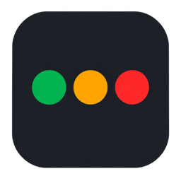
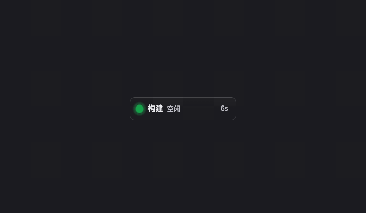
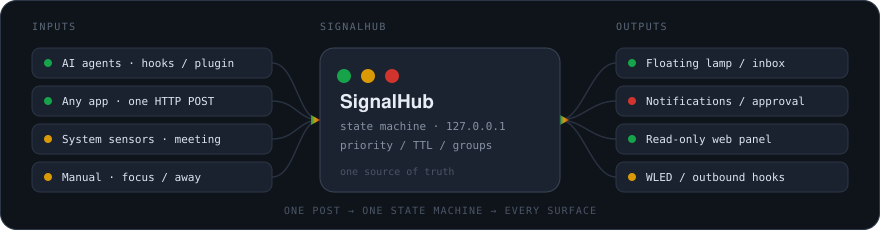

<div align="center">



<h1>SignalHub</h1>

<p><strong>给桌面装一盏灯 —— 所有智能体在做什么，一眼就看得见。</strong></p>

<p><sub><strong>中文</strong> · <a href="README.en.md">English</a> &nbsp;·&nbsp; macOS / Windows / Linux</sub></p>

<p>
  
  
  
</p>

</div>

<p align="center">
  
</p>

<p align="center"><sub>十种状态一轮看完。折叠、审批、圆环菜单、收件箱、留言等真实操作见 <a href="docs/scenes.md">八段场景动图</a>。</sub></p>

## 这是什么

桌面上一盏常驻的灯。你和智能体现在在做什么，用颜色和闪烁节奏就能看出来，不用切回终端。

- **一次接入，十家智能体**：Claude Code / CSC / Codex / Cursor / Gemini CLI / Goose / opencode / Pi / Hermes / WorkBuddy，一行命令装好 hook；装完重启智能体即可。
- **不绑定智能体**：任何程序发一个 HTTP 请求就能上报状态。
- **状态只在本机**：默认只监听 `127.0.0.1`。局域网访问、手机面板、转发这些开关默认全关，要你自己打开。

## 30 秒上手

```bash
signalhub install hooks claude-code   # 接上智能体，装完重启它
signalhub working --session demo      # 或者自己报一条状态
```

之后：提问 → 绿灯快闪，调工具 → 绿灯慢闪，需要授权 → 红灯，答完闪一下再落定。详见[接入智能体](#接入智能体)。

### 一条上报，处处可见



一个 HTTP POST 进**一处状态机**，再分发到悬浮灯、收件箱、系统通知、只读 Web 面板、手机推送、WLED 物理灯和多机汇总。输入侧可以是 hook、任意程序、系统采集器，甚至托盘里的「专注 25 分钟」——走同一条路，所以统计、历史、转发自动认，没有第二套状态机。接口见[上报状态](#上报状态)。

## 状态一眼看懂

| 状态 | 视觉 | 含义 |
|---|---|---|
| `idle` | 绿、常亮 | 空闲 |
| `thinking` | 绿、快闪 | 正在推理 |
| `working` | 绿、慢闪 | 正在执行 |
| `done` | 绿、常亮 + 闪一下 | 完成（默认 3 分钟后消失，可调） |
| `attention` | 黄、闪 | 需要关注 |
| `permission` | 红、平滑闪 | 需要授权 |
| `error` | 红、频闪 | 出错 / 阻塞 |
| `stale` | 灰、常亮 | 有会话，但它不说话了 |
| `offline` | 灰、更淡 | 一个会话都没有 |
| `off` | 灰、更淡 | 监控被暂停 |

优先级 **红 > 黄 > 绿**：一组在等授权时，别的组报「执行中」不会把红灯顶掉。全局取各组里最高的。

不靠颜色也能分辨：需要授权 / 出错的灯珠是**圆角方**、其余是圆；`stale` 带一圈随剩余宽限期缩短的**细环**；默认开**安静模式**，空闲 / 沉默 / 离线时几乎透明，有事才显形。

## 它都能做什么

**灯本身** —— 一块深色圆角牌 = 一组，最紧急的排最前；多块同时在等你的更醒目，其余退后一档，几块在干活的呼吸节奏按组错开。单击在「一叠牌 / 一颗灯」之间折叠（竖排或横排，可带组名 / 序号 / 状态，超出上限的折成带状态色的 `+N`）；长按约半秒呼出圆环菜单；拖动会记住位置；右键牌面能隐藏、静音、推迟 15 分钟、清状态，菜单顶部还会说明这块牌**为什么是这个样子**。

**外观随便调** —— 六档灯珠形状、四档牌轮廓、五套皮肤、六个独立灯位（上沿 / 下沿各一枚短刻线 + 行尾四格，各挑画法和九种触发条件）、效果五档、灯牌上限（默认 6，可调 4–8）。颜色 / 形状 / 节奏也能逐个状态覆盖。设置 → 灯。

**收件箱与审批** —— 长按灯或 `⌃⌥I` 打开，按「需要你 → 运行中 → 刚刚完成 → 空闲」列会话：允许 / 拒绝、跳转到对应终端标签页、静音、清掉、「跑完叫我」，离开超过 10 分钟回来还有一句话摘要。「从灯上审批」把 Claude Code 的确认框搬到灯上（**默认关**），危险命令要按住 800ms，看不全的命令只给拒绝，**永远不替你说「允许」**。

**通知** —— 进入「需要授权 / 关注 / 出错」时弹一条，只在跃迁时弹一次、要持续 5 秒才弹（均可调）。可按组静音、设勿扰时段、加提示音；点通知本体直接打开项目目录。还有三条预设：授权卡住 60 秒补推手机、有会话在跑时静音、开会时会议牌变蓝并静音。

**展示模式** —— `⌥⌘P` 在鼠标所在屏幕铺一张大屏看板，每块牌一颗同源灯珠 + 组名 / 状态 / 时长，三米外也读得出。只放灯本来就有的语义（不搬命令正文和消息），投屏天然脱敏。默认关、不自动、不防休眠，`Esc` 或托盘退出；与点击穿透互斥。

**会话管理** —— 设置左栏「会话」页：按组列出所有会话，可复制 ID、打开工作目录、清除单个或一键清空全部；改名 / 置顶 / 隐藏 / 静音的「各组的显示」也搬到了这一页。

**你自己也是信号源** —— 托盘 →「手动状态」里有专注 25 分钟、开会中、离开，就是普通的一组，统计 / 历史 / 转发自动认。

**六个快捷键** —— `⌃⌥I` 收件箱 · `⌃⌥L` 显示 / 隐藏灯 · `⌃⌥M` 静音最差组 · `⌃⌥0` 清最差组 · `⌃⌥S` 点击穿透 · `⌥⌘P` 展示模式。Windows / Linux 是 `Ctrl+Alt+I / L / M / 0 / S` 和 `Ctrl+Alt+P`。抢不到的那个会在设置里标出来。

**转发与远端** —— 出站钩子把状态 POST 到 ntfy / Slack / 自建接口或跑本地命令；只读 Web 面板给一条带 token 的链接，手机浏览器就能看灯（默认关）；WLED 物理灯只收状态色；多机模式把别的机器的看板拉进同一盏灯，对端不用升级。

**Call Me** —— 反过来的通道：把一条链接贴进文章，读到它的智能体通过你自己部署的服务器给你留言，桌面端拉回来在「设置 → 工作台 → 留言」里读。

**先看再装** —— 设置 →「演示」用真实的灯牌 / 收件箱 / 圆环组件播剧本，不碰真实状态；浏览器打开 `?window=demo` 是同一段独立页。

> 上面是速览。设计取舍、边界与踩过的坑见[架构文档](docs/architecture.md)，逐次改动记在它的 §3.35 小节里。

## 文档地图

| 想做什么 | 去哪 |
|---|---|
| 下载安装、从源码跑 | [安装](#安装) · [从源码运行](#从源码运行) |
| 用 HTTP / CLI 上报 | [上报状态](#上报状态) |
| 接某个智能体、自定义接入 | [接入智能体](#接入智能体) |
| 把多台机器合并 | [多机 / 团队](#多机--团队) |
| 部署留言服务器 | [Call Me](#call-me) |
| 看真实操作动图 | [八段场景](docs/scenes.md) |
| 完整接口规范 | [API 文档](docs/api.md) |
| 设计取舍 | [架构文档](docs/architecture.md) |
| Call Me 部署 / 排障 | [Call Me 文档](docs/callme.md) |
| 待办与已知边界 | [backlog](docs/backlog.md) |

## 安装

从 [Releases](https://github.com/iFishin/SignalHub/releases) 下载：

- **macOS** —— `.dmg`，拖进「应用程序」。Apple Silicon 选 `aarch64`，Intel 选 `x64`。
- **Windows** —— `-setup.exe`（NSIS 安装器）或 `_x64_portable.zip`（解压即用）。
  免安装版首次启动会为了系统通知，在当前用户下补一个带应用身份的开始菜单快捷方式和
  一个 `HKCU` 键；不需要管理员权限，也不是安装器（原因见 [架构文档 §3.30](docs/architecture.md)）。
  通知仍然不弹时，先看「设置 → 通知 → 提醒」顶部的状态是不是「未注册」。
- **Linux（beta）** —— `.AppImage` 或 `.deb`。透明和置顶在 Wayland 下不一定生效，
  碰上就 `GDK_BACKEND=x11` 启动；没有 FUSE 的环境加 `--appimage-extract-and-run`。

安装包**没有签名**，所以第一次打开会被拦一道。macOS 上**推荐**在终端里跑：

```bash
xattr -dr com.apple.quarantine /Applications/SignalHub.app
```

它递归清掉整个包的隔离标记 —— 应用和打包在里面的 `signalhub` 命令都覆盖到。（右键点图标 →「打开」→ 再点一次也可以，只是不保证覆盖到里面那个命令。）Windows 上在 SmartScreen 里点「更多信息」→「仍要运行」。

`signalhub` 这个命令**已经打包在应用里**，不用另外装 —— 「设置 → 接入」页的一键接入会自己用它。想在终端里直接用，把它加到 PATH：

```bash
ln -sfn /Applications/SignalHub.app/Contents/MacOS/signalhub /usr/local/bin/signalhub
```

**更新**：macOS 版从 0.2.4 起支持**应用内更新**（设置 →「系统 → 更新与诊断」页会显示有没有新版本，「下载并安装」点了才装，默认不自动装）。Linux 和 Windows 这一版还只能手动下载 —— Windows 要用的解包库被上游全量撤下了，Linux 侧还没在真机上验收过（原因写在 [.github/release-body.md](.github/release-body.md)）。打一个 `v` 开头的 tag 就会自动出四个平台的包，见 [release.yml](.github/workflows/release.yml)。

## 从源码运行

需要 Node.js 与 Rust 工具链。Linux 上还要先装一批系统库（清单见 `.github/workflows/release.yml` 的「装 Linux 系统依赖」那一步）。

```bash
npm install
npm run tauri dev
```

**跑 `cargo test` 之前要先 `npm run stage-cli`。** CLI 是作为 sidecar 打进应用包的，而 `tauri-build` 在**构建脚本阶段**就校验那个文件在不在 —— 少了它连 `cargo test` 都编不过。`tauri dev` / `tauri build` 会自己先跑这一步，只有直接调 `cargo` 时才需要手动补一次（`cargo clean` 之后也要重跑）。

**报 `failed to read file 'capabilities/._default.json': stream did not contain valid UTF-8`** 时，先删 `src-tauri/capabilities/` 下的 `._*` 文件再重跑：仓库放在 exFAT / NTFS 外接卷上时，macOS 每次写文件都会在旁边生成一个同名的 AppleDouble 元数据文件，而 `tauri-build` 会把权限目录里**每个**文件当 UTF-8 读。这类文件已在 `.gitignore` 里，删掉不影响仓库；外接卷上建议把 `CARGO_TARGET_DIR` 指到 APFS（见 `.cargo/config.toml`）。

首次启动会在 `~/.signalhub/`（Windows 是 `%USERPROFILE%\.signalhub`）下生成 `port` 和 `token`。窗口无边框、不进任务栏也不进 Dock，**退出请用菜单栏的托盘图标**。

## 上报状态

HTTP 接口（默认 `127.0.0.1:41320`，端口以 `~/.signalhub/port` 为准）。**默认只监听本机**：

```bash
curl -s -X POST "http://127.0.0.1:$(cat ~/.signalhub/port)/v1/state" \
  -H "Authorization: Bearer $(cat ~/.signalhub/token)" \
  -H 'Content-Type: application/json' \
  -d '{"state":"permission","session":"demo","message":"需要批准"}'
```

Windows 上用 PowerShell：

```powershell
$dir = "$env:USERPROFILE\.signalhub"
$port = Get-Content "$dir\port"
$token = Get-Content "$dir\token"
Invoke-RestMethod -Method Post "http://127.0.0.1:$port/v1/state" `
  -Headers @{ Authorization = "Bearer $token" } `
  -ContentType 'application/json' `
  -Body '{"state":"permission","session":"demo","message":"需要批准"}'
```

**别的机器上报**：设置 →「接入」里打开「允许局域网访问」（默认关），服务改绑 `0.0.0.0`，同网段的机器 / 容器 / WSL 就能连进来 —— 代价是网内任何人拿到 token 都能上报，别在公共 WiFi 上开。改完要重启应用。

用 CLI 也行：

```bash
signalhub working --session build-1 --agent ci --message "compiling"
signalhub status
signalhub watch                                   # 终端里跟随状态变化
signalhub watch --until done --timeout 10m        # CI 里等某个状态
```

完整接口规范见 [docs/api.md](docs/api.md)。

## 接入智能体

```bash
signalhub install hooks claude-code      # 也支持 csc / codex / cursor / gemini / goose / workbuddy / opencode / pi / hermes
signalhub install hooks claude-code --dry-run   # 先看看会改什么
```

它只动智能体配置文件里的 `hooks` 键，其余原样保留，写之前自动备份到 `*.signalhub-backup`；重复执行不产生重复条目，命令变了原地更新，配置不是合法 JSON 就中止。卸载用 `signalhub uninstall hooks claude-code`。Goose / opencode / Pi / Hermes 走插件机制（装的是我们自己的一个目录或文件），不碰共享配置，卸载时整份删掉。

装完重启智能体即可生效。各家差异（哪家没有「需要授权」事件、字段名不一样）见 [docs/api.md §4](docs/api.md)。

**清单里没有的智能体**：大多是 Claude Code 的同构克隆，一条命令登记即可：

```bash
signalhub add-agent --id my-agent --name "My Agent" \
  --family claude-code --config ".my-agent/settings.json" \
  --marker ".my-agent" --command my-agent
signalhub install hooks my-agent
```

校验、保留已有条目、原子写回都由命令负责。也可以直接用「设置 → 接入 → 自定义智能体 → 复制接入提示词」让智能体自己配。字段表见 [docs/api.md §4.18](docs/api.md)。

建议先把 CLI 放进 PATH，这样写进配置的是可移植的裸名字：macOS / Linux 用 `ln -sfn "$(pwd)/src-tauri/target/debug/signalhub" ~/.local/bin/signalhub`；Windows 把 `src-tauri\target\debug` 追加进用户 PATH 再重开终端。绝对路径也能用，但二进制一挪动 hook 就会静默失效。

## 多机 / 团队

一台机器设成 hub，灯上就会出现所有机器：

```
mac-mini · ci          需要授权
server · build         执行中 · 正在跑 npm test
default                空闲
```

两步都在 **hub** 这边：① 在**对端**打开「设置 → 接入 → 允许局域网访问」；② 在 hub 的「设置 → 多机」里加一条（名称、对端地址、对端 token），点「测试连接」当场验证。对端不用升级，hub 拉的是从 0.1 就有的 `GET /v1/state`。

远程会话和本机会话一样参与聚合、收件箱、统计，但只读（不能审批、不能跳转终端）；对端掉线 6 秒转灰，连续 3 次失败多一块「连不上」的牌。只能直连（局域网 / VPN / 隧道），没有中继。取舍见[架构文档 §3.26](docs/architecture.md)。

## Call Me

灯答的是「我的智能体在干什么」；**Call Me 反过来**：你在文章里贴一条链接，读到它的智能体通过**你自己部署的服务器**给你留言，桌面端拉回来在「设置 → 工作台 → 留言」里读，旁边有「打开出处」。

```
外部 AI 智能体 ──POST /c/<token>──▶ signalhub-callme（你的服务器，Docker 一条命令）
桌面端「设置 → 工作台 → 留言」──每 15 秒拉一次──▶ 留言列表（已读 / 按来源筛选 / 打开出处）
```

- **每处一条链接**：令牌在链接里，来源不可伪造；每条可单独改名、吊销、删除、限额。
- **防滥用**：每 IP 10 条/时、每条链接 50 条/24 小时、正文 4000 字；带浏览器 `Origin` 的请求一律拒绝。
- **先跑通再上线**：设置 → 连接 → Call Me → 服务器 →「启动」在本机 `127.0.0.1:43877` 起同一份服务，只监听回环，退出应用即停。
- 服务器是独立 crate（`server/`），不链接 Tauri，裸 VPS / 容器能直接跑；TLS 交给反代。

```bash
docker build -t signalhub-callme ./server
docker run -d -p 8080:8080 -e CALLME_ADMIN_TOKEN="$(openssl rand -hex 24)" \
  -v callme-data:/data signalhub-callme
```

部署细节见 [docs/callme.md](docs/callme.md)，接口见 [docs/api.md §9](docs/api.md)。

## 进度

已完成：悬浮灯、状态聚合与 TTL、HTTP 接口与 CLI、设置面板、十家智能体一键接入、通知、审批、展示模式、多机、手机面板、转发、WLED、Call Me、统计与历史、会话管理等，详见[架构文档](docs/architecture.md)的 §3.35 逐次改动记录。

待做：签名与公证（步骤位置留在 [release.yml](.github/workflows/release.yml)，拿到证书就能填）。完整的待办、待验收与已知边界见 [docs/backlog.md](docs/backlog.md)。macOS 已接应用内更新（手动触发）；Linux / Windows 还没接，理由写在 [update.rs](src-tauri/src/update.rs) 模块头。

## 许可证

MIT，见 [LICENSE](LICENSE)。
