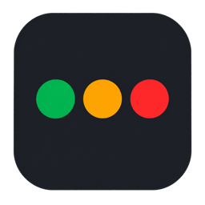
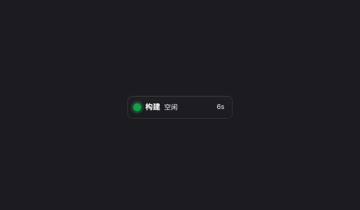
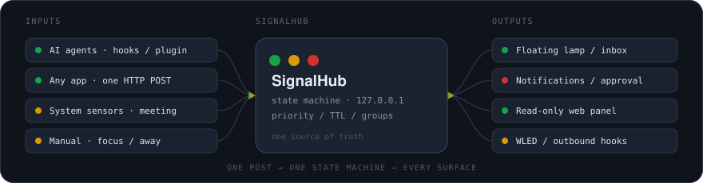

<div align="center">



<h1>SignalHub</h1>

<p><strong>给桌面装一盏灯 —— 所有智能体在做什么，一眼就看得见。</strong></p>

<p><sub><strong>中文</strong> · <a href="README.en.md">English</a> &nbsp;·&nbsp; macOS / Windows / Linux</sub></p>

<p>
  
  
  
</p>

</div>



<sub>这段动图不是录屏：颜色与闪烁节奏直接取自 <a href="src/styles/state.css"><code>state.css</code></a> / <a href="src/styles/lamp.css"><code>lamp.css</code></a>（绿 <code>#16a34a</code>、红 <code>#d0342c</code>，640 / 1600 / 900 ms），连 <code>permission</code> 的圆角方灯珠、安静模式的半透明牌、以及危险命令的「允许」要按住 800 ms 都照着代码画。改了默认灯效就跑 <a href="scripts/render-demo.sh"><code>sh scripts/render-demo.sh</code></a> 重画。</sub>

## 这是什么

跨平台的桌面悬浮状态指示器。一组始终置顶、可拖拽的透明状态牌，用颜色和明暗节奏表示当前状态；单击折叠成一颗单纯的灯，长按呼出圆环菜单打开「收件箱」。

优先适配 AI 智能体：**Claude Code / Codex / Cursor / Gemini CLI / Goose / WorkBuddy / opencode / Pi / Hermes 都能一键接入**（大部分把 hook 写进它们自己的配置文件，opencode / Pi / Hermes 装的是插件文件）。但**不绑定智能体**——任何程序只要能发一个 HTTP 请求就能上报状态。

```bash
signalhub install hooks claude-code   # 一行接上智能体，装完重启它
signalhub working --session demo     # 或者自己报一条状态
```

### 一条上报，处处可见



**一个 HTTP POST 进一处状态机，再分发到所有出口**：悬浮灯、收件箱、系统通知、只读 Web 面板、手机推送、WLED 物理灯，以及多机汇总。输入侧可以是智能体的 hook、任意程序、系统采集器，甚至是托盘里的「专注 25 分钟」——它们走同一条路，所以统计 / 历史 / 转发全都自动认，没有第二套状态机。接口见[上报状态](#上报状态)。

## 状态

| 状态 | 视觉 | 含义 |
|---|---|---|
| `idle` | 绿、常亮 | 空闲 |
| `thinking` | 绿、快闪 | 正在推理 |
| `working` | 绿、慢闪 | 正在执行 |
| `done` | 绿、常亮 + 闪一下 | 完成（默认 3 分钟后消失，可调） |
| `attention` | 黄、闪 | 需要关注 |
| `permission` | 红、平滑闪 | 需要授权 |
| `error` | 红、频闪 | 出错 / 阻塞 |
| `stale` | 灰、常亮 | 有会话，但它不说话了 |
| `offline` | 灰、更淡 | 一个会话都没有 |
| `off` | 灰、更淡 | 监控被暂停 |

优先级 **红 > 黄 > 绿**：一组在等授权时，别的组报「正在执行」不会把红灯顶掉；等授权的那一组自己恢复工作后，红又会自然消失。全局取各组里最高的优先级。

**每块牌**是一块深色圆角牌（和应用图标同一套语言）：彩点 + 组名 + 状态 + 已持续，有消息时多一行。**同时有多块牌时，在等你的那几块更响** —— 授权 / 关注 / 出错时彩点更大、牌面更实，其余（执行中 / 完成 / 空闲…）退后一档，余光里就能看出该先看哪块；只有一块牌时不分层，因为那时候比较没有意义，压淡只会让整盏灯变淡。状态词在灯上用两字短词（「授权」「执行」「完成」），把宽度让给组名。

**分组**由上报方决定 —— 上报时带一个可选的 `group`（HTTP 请求体里的 `group` 字段，或命令行的 `--group`）：

```bash
curl -s -X POST ... -d '{"state":"working","session":"a","group":"work"}'
curl -s -X POST ... -d '{"state":"error","session":"b","group":"ci"}'

signalhub working --session a --group work
signalhub error --session b --group ci
```

于是灯球上出现两块牌（最紧急的排在最前），全局聚合取各组里最高的那个。不带 `group` 就归 `default`，行为与单组完全一样。装出来的 hook 命令不带 `--group`，所以接上的智能体现在仍然全在 `default` 组里 —— 多分组是给显式要多组的场景准备的。

**上报方还能声明自己是哪一类信号源**（`--source agent|system|custom`，缺省按名字推）：接入页据此把「收到过上报、但不在智能体清单里」的那些分成**系统**和**自定义**两组，好让「盯系统状态的守护脚本」和「我自己的小工具」不至于混在一起。`signalhub hook` 报的是 `agent`；`signalhub run` 包的命令、以及你手写的 `signalhub working` 落在 `custom`；`--source system` 就是系统那一组（内置的「会议」「备份」采集器报的就是它）。**它只影响接入页怎么分组** —— 灯的聚合、分组、超时、通知都与之无关，填错或不填，灯的表现一模一样。

**这台机器自己的状态也能当信号源。** 接入页的「系统信号源」一节里有两个内置采集器，**默认都关**：**会议中**（麦克风或摄像头被任何应用占用 → 灯上多一组「会议」，结束后自动报「会议结束」）和 **Time Machine 备份中**（`tmutil status` → 一组「备份」，跑完自动报「备份完成」）。它们每 5 秒读一次系统状态，**只读「设备在不在用」/「备份在不在跑」，不采集、不保存任何声音、画面或文件内容**，读这些状态不会弹麦克风 / 摄像头的权限请求；采集线程出错时只记一行日志、并把那一组交给 15 秒的 TTL 自然消失，不会留下一条假状态。两个采集器只有 macOS 有，别的平台这一节里不会出现。

不想每次上手写 `group` 的话，设置面板 → 接入里有个**按工作目录分组**的开关：打开后，没带 `group` 的上报按各自的 `cwd` 自动分组，一个目录一块牌，每个项目各占一行。上报自己带了 `group` 的仍然听它的，所以两种用法可以混着来。组名就是那条路径，嫌长可以去「外观 → 各组的显示」改名。**默认是关的**，所以升级不会让任何人的灯突然多出几块牌来。

**每组的显示名和位置也能调**（设置面板 → 外观 → 各组的显示）：组名是上报方给的标识（`build-1` 这种），可以改成「构建」；也可以把某个组**置顶**，让它永远排在灯上最前面 —— 没置顶的组仍然按紧急程度排，所以一盏红灯不会被挤到绿灯下面。这两样只影响显示：接口里的组名、隐藏 / 静音的匹配都不变。

三处不靠颜色的信息通道：

- **形状**：默认 `permission` / `error` 的灯是圆角方形，其余是圆形。红绿是色盲最难分的一对，而这两个恰好最需要你注意。
- **细环**：`stale` 的灯上是细环，按剩余宽限期缩短，一眼看出「沉默多久了」。
- **明暗**：默认开启「安静模式」——空闲 / 沉默 / 离线时整块牌几乎透明，只有真正有活动或需要你注意时才显形，鼠标悬停恢复。可在设置里关掉。

**外观可调**（设置面板 → 外观）：四套预设（单灯 / 紧凑 / 标准 / 醒目）一键定调，也可以逐项调——形态（展开成牌 / 折叠成一颗灯）、大小（整块牌的尺度）、形状、配色方案、背景透明度、闪烁节奏，以及牌上显示哪几段（组名 / 状态 / 已持续 / 消息）。

**每个状态都能单独调**（设置面板 → 灯效）：颜色、形状、节奏三样各自覆盖，没写的跟随「外观」页那几项全局默认；另有四套灯效预设（跟随全局 / 形状区分 / 节奏分级 / 只在需要时闪）一键定调。

**需要你注意时弹系统通知**：聚合新变成「需要授权 / 需要关注 / 出错」时弹一条，正文是项目名加智能体自己写的说明。只在跃迁时弹一次，不是每次状态变化都弹——一轮工具调用会触发几十次推送，每次都弹就成了骚扰。状态要**持续**够久（默认 5 秒，可调）才提醒，滤掉一秒内进出 `permission` 那种一闪而过。可以给通知带上提示音（macOS / Windows 上生效），可以**按组静音**（只影响通知和声音，灯照常显示），也可以设一段**勿扰时段**（只按小时，跨午夜也认；这段时间不弹也不出声，而且不补发——早上醒来收到一堆昨晚的通知正是它要避免的）。还有三条**预设规则**（默认关、各自一个开关）：授权卡住 60 秒时用「转发」里配好的手机推送钩子再推一次；有智能体在思考 / 执行时暂停通知；开会时（配合「会议中」采集器）会议那块牌变蓝并静音。它们只决定「什么时候打扰你」，不做表达式引擎。通知上还有两个按钮：**打开项目目录**和**静音该组**——不用自己回终端里找是哪个项目。

**也能转发到别处**：在「转发」页配置若干条出站钩子 —— 状态变化时 POST 到某个地址（ntfy、Slack、自建接口）或跑一条本地命令，每条可以只对指定状态生效。常用服务有现成预设；接自建接口时选「自定义请求体」，用 `{state}` / `{group}` / `{message}` 这类占位符写自己的 JSON。异步执行、带超时，目标挂掉不影响本地。格式、占位符与安全说明见 [docs/api.md §4.9](docs/api.md)。

**桌面之外也有一盏灯**：「转发」页最下面填一台 WLED 的地址，状态色就直接 POST 到它上面（`POST /json/state`），桌边那盏灯跟着状态变色 —— 不看屏幕也知道现在什么情况。发出去的东西**只有颜色**：没有组名、没有会话名、没有消息内容。填完保存就会立刻按当前状态亮一次，那一下就是「通不通」的回答，结果和出站钩子记在同一份日志里（`ok 200 success` = 通了）。默认一台都不配。

**手机上也能看**：设置 → 接入 → 只读 Web 面板 打开后，有一条带 token 的链接（可复制），在手机 / 平板的浏览器里打开就能看灯 —— 状态、每组在做什么、已持续多久，只读，不用装任何东西。**默认关**，而且它和上报服务共用监听地址：只有同时打开「允许局域网访问」，同一 WiFi 下的设备才看得到（那时设置页会提醒「链接别外传，也别在公共 WiFi 上开着」）。

**手机上也点得动**（「在面板上审批」，默认关，得先打开「从灯上审批」）：打开后，等你批准的调用会出现在那个页面上，可以直接点「允许 / 拒绝」，拒绝还能选一句理由。危险命令照样有红横幅、允许照样要按住 0.8 秒，看不全的照样只能拒绝 —— 手机误触比鼠标更常见，这几样一个没省。**这是一次明确的扩大暴露面**：面板从此会把命令原文和文件路径画出来，所以它是独立的一个开关，而不是跟着面板一起开；关着的时候页面连审批列表都不会去拉。它**不是安全边界** —— 拿到那条链接的人本来就能直接问接口，真正的门仍然是 token（手机丢了就去删 `~/.signalhub/token` 再重启）。

**收件箱**（长按灯呼出的圆环菜单、`⌃⌥I`、或托盘菜单第一项）：按「需要你 → 运行中 → 刚刚完成 → 空闲」列出所有会话。待审批的条目可以直接「允许 / 拒绝」；每一行都能「跳转」到对应的终端标签页（Terminal / iTerm2 / tmux；第一次会请求「控制终端」的自动化权限）、静音该组、清掉这个会话，或者点「**跑完叫我**」盯住它 —— 这条会话完成、出错或被清掉时弹一条通知，不用一直瞄着灯（一次性订阅，叫完就取消；远程会话只是拉取掉线不算，重启不保留，也不受勿扰时段影响，因为它是你点名要的那一条）。没有要处理的事时它是一块安静的空板，不抢注意力 —— 空板上直接给「接入智能体」和「看演示」两条出路，第一次打开的人不用自己找。**离开一阵子再回来**（超过 10 分钟）时，顶部会多一句话：`你离开的 47m 里 2 个在等你 · 1 个失败 · 3 个完成` —— 判据是每条会话当前状态的起点晚于「上次看过收件箱」，加上事件流水里那些**跑完就已经从列表消失**的会话（会单独说「另有 N 个跑完就结束了」），所以不用自己翻一遍列表猜这段时间发生了什么；什么都没变就说「没有新动静」。**单击灯**在「一叠牌」和「一颗灯」之间切换，选择会记住（设置 →「行为」里可以把单击改成打开收件箱或什么都不做）。**右键点某一块牌**可以隐藏该组、静音该组、清掉该组的状态、切形态或打开设置。悬浮窗会记住自己被你拖到的位置。「历史」页顶部显示今日各状态的累计时长，「状态」页还有一条近 30 分钟的时间线（每段的宽度就是它的时长）。收件箱每行只有两行字：项目名和右对齐的「等了多久」在上面，机器 / 智能体 / 目录 / 状态在下面一行灰字里；动作只常驻「允许 / 拒绝 / 跳转」，盯住 / 静音 / 清除收在行尾的 `⋯` 后面（点开才展开，不会在你要点「允许」的时候把按钮挪走），`M` / `W` 也能直接静音 / 盯住；收件箱和设置窗都能拖大（灯窗仍由 Rust 按内容精确算尺寸，不能拉）。

**五个全局快捷键**（设置 →「系统 → 通用」页列着它们，抢不到的那一个也会在那里标出来）：`⌃⌥I` 打开收件箱、`⌃⌥L` 显示 / 隐藏灯、`⌃⌥M` 静音 / 取消静音「最差的那一组」、`⌃⌥0` 清除最差那一组的状态、`⌃⌥S` 切换点击穿透。Windows / Linux 上是 `Ctrl+Alt+I / L / M / 0 / S`。「最差的那一组」= 紧急度最高的那一组（和灯上最上面那块牌同一个判据；置顶只改显示顺序）。静音只影响通知和提示音、灯照常显示那一组，所以按下去会弹一条通告说清楚它做了什么。这几个**刻意不做可配** —— 真正的故障是被别的程序占了，而那件事可配也解决不了，所以抢不到的那个会被明确标出来，而不是变成一个按了没反应的键。开启点击穿透后，托盘里那一项会变成「退出点击穿透 · ⌃⌥S」—— 通知只弹一次，菜单是随时能回去查的那一处。

**你自己也是一个信号源**：托盘菜单 →「手动状态」里有「专注 25 分钟」（灯上出现一个倒计时，每分钟走一格，到点提醒并转「已完成」）、「开会中」、「离开」（两块灰牌 —— 安静模式下半透明，从房间另一头看过来就是「这儿没在忙」，牌上那行字说清是哪种）和「清除手动状态」。它们**就是普通的一组分**（组名「我」/「Me」，跟着界面语言），所以统计、历史、只读面板、转发钩子、物理灯全都自动认它，没有第二套状态机。开会和离开只占一盏灯、**不动通知设置**：想「别打扰我」用托盘里的「暂停 / 恢复监控」。这一节也是「信号中枢在没有任何智能体时也有用」的最低成本证明。

**从灯上审批**（设置 → 接入 → 从灯上审批，**默认关**）：打开之后，Claude Code 每次要问你批准某个工具调用时，那个确认框会被搬到灯上 —— 灯上弹一条气泡，点「允许」或「拒绝」，或者不管它（45 秒后交回终端里那个确认框）。**这是唯一会改变智能体行为的功能**，所以它只在「它本来就要问你」的那一刻生效（`PermissionRequest`），不拦别的工具调用；**永远不替你说「允许」**（超时、被顶掉、开关关掉、绑着局域网，一律什么都不说，回到终端里问）；**看不全就不给放行** —— 命令超过 240 字符算截断，那条只能拒绝或者回终端自己看（一条在灯上看不全的命令不该被一键放行）。写文件 / 改文件时，气泡里还能看到**要写进去的头几行**（`(+3)` 是行数，`+` / `-` 是加的和删的，底下还有就写 `… +497`），跑命令时能看到它从哪个目录算起（`@ /path`）—— 不用为了「写什么」再跑一趟终端。命令全文只出现在本机这个窗口里，状态上报仍然只有「执行 npm」那个短词，通知和转发钩子都不带它。端点要 token（装进 `~/.claude/settings.json` 的那一条自带），卸载会把带 token 的那条一起清掉。命令行装法：`signalhub install hooks claude-code --approve`（装完还要在接入页打开那个开关 —— 它才是真正的闸门）。

**目前只支持 Claude Code，而且必须用 HTTP 方式接入**：`install_approve`、`approve_url` 和审批端点的路径校验都只认 `claude-code`，接入页那个开关也只出现在它的卡片上。其他智能体（**包括 WorkBuddy**）要授权时，灯照样变红、通知照样发，但确认框留在智能体自己的界面里 —— 请回到那边点允许 / 拒绝。桌面版 WorkBuddy 实测不触发 `PermissionRequest` hook（本机 hooks 日志里一次都没有，报上来的红色来自 `Notification` 的 `permission_prompt`），而官方 hooks 文档也没写清 HTTP hook 能否回一个决定，所以这里没有硬把白名单放开：摆一个点了没反应的开关，比不摆更坏。

**它不只是把按钮搬个地方**，还多做三件事：

- **危险的东西要按住**：`rm -rf`、`git push --force`、`git reset --hard`、`DROP TABLE`、`curl | sh`、`mkfs`、`chmod 777`、`sudo` 这类命令会有一条红色横幅（「这条会删数据」），「允许」要**按住 800ms** 才生效，拒绝仍然一键。它**只强调、不拦截、也不自动拒绝** —— 误报的代价只是多按一下，所以宁可少认几种（`rm notes.txt` 不会被染红）。分类和「能不能放行」是两件事：危险不改变放行规则，看不全才不给放行。
- **拒绝能说清理由**：拒绝旁边一个小箭头，展开「太危险」「换更安全的做法」「先解释再试」，收件箱里还能自己写一句（截 200 字）。理由会作为 `hookSpecificOutput.decision.message` 进模型上下文 —— **那句话是英文**（模型读英文），界面上的中文只是同一个键的另一面。不带理由的拒绝和以前逐字节一样；认不出来的理由键一律退回默认那句，**拒绝不会因为参数写错而失效**。
- **批过什么查得到**：设置 →「历史」页在今日统计下面多一段「审批记录」——时间、允许 / 拒绝 / 超时、工具、目标、是谁点的（灯窗 / 接口 / 网页）。同时落到 `~/.signalhub/approvals/YYYY-MM-DD.jsonl`（保留 30 天，`0600`），离开一会儿回来能补上，出事能回溯「谁放行的 `rm -rf`」。盘上那份的详情只留 200 字符 —— 屏幕要「现在看全」，硬盘要「以后大概知道」，`API_KEY=…` 不该永久躺在磁盘上。

**每个状态都有静默超时**（`working` 600 秒、`attention` / `error` 300 秒，`thinking` / `permission` / `idle` 600 秒，`done` 180 秒；都能在「行为 → 静默超时」或「外观 → 逐个状态覆盖」里改）。超时之后怎么显示，取决于这一路上报**知不知道智能体的进程号**：

- **知道**（Claude Code 的命令式 hook —— 各平台都有、opencode / Pi / Hermes 的插件、`signalhub run`；Claude Code 如果选了 HTTP 接入就不带进程号）：进程还活着 → **保持最后的状态**（一次 20 分钟的构建、十分钟的推理期间一个事件都没有，灯仍然是「执行中」/「思考中」；一轮什么时候结束由智能体自己的结束事件决定）；进程真没了 → 立刻清掉，不用等超时。**「需要授权 / 注意 / 出错」这三档不这么改判** —— 进程活着不能说明那件事已经过去了，它们照旧转沉默。
- **不知道**（HTTP 上报、手写命令、其余几家 hook）：照旧转入 `stale`（灰、常亮），再过 30 分钟才真正删除。**但一次工具调用开始时会自动给 30 分钟** —— 见下。

**长任务不该被当成「沉默」**（issue #23）：没有进程号的那一路上，`working` 默认只活 10 分钟，而一次 `npm run build` / 跑测试轻易超过 5 分钟，这期间智能体**一个 hook 事件都不会发**（`PostToolUse` 要等工具结束才来）。所以 `PreToolUse` 那一帧会自带 30 分钟停留时长：只要工具还在跑，灯就不会灰。工具**结束**的那一帧不延长（之后马上会有下一个事件，用默认值更诚实 —— 真挂了 10 分钟就灰，而不是半小时）。

**干完活之后灯不会立刻翻脸说「没有智能体在上报」。** `done` 的牌到期是被整个删掉的（不是转「沉默」），所以那一刻灯上本该只剩一句「没有智能体在上报」—— 而那正是「刚才那个任务完成了吗」最想问的时候。灯记着最近一次完成的时刻：十分钟之内，空状态说的是「**刚完成 · 2 分钟前**」，过了十分钟才退回「没有智能体在上报」。这份记忆只管**显示**，不改变任何状态判断。

这样「智能体崩溃了/不说话了」和「智能体空闲待命」是两种不同的显示——不会出现「智能体早就没了，灯还在闪」的情况。**老版本装过的 hook 要回「接入」页重装一次**才会带上 `$PPID` 前缀（只有 macOS / Linux 需要）；没重装的照旧按沉默处理（但同样吃上面那条 30 分钟）。Windows 不用重装。

进程探活在 macOS / Linux 上用 `kill(pid, 0)`、在 Windows 上用 `OpenProcess` + `WaitForSingleObject`，**两个平台都生效**。Windows 的命令式 hook 过去拿不到进程号，现在由 CLI 自己沿父进程链找到智能体再上报（跳过 `cmd.exe` 这类短命 shell）；**找不到就不报、退回上面那条 30 分钟兜底**，绝不会把短命 shell 当成智能体、把一块正亮着的牌抹掉。⚠️ 各家在 Windows 上的父进程派生方式**还没在真机上实测过**，这是保守近似，判据与排除表写在 `win_pid.rs` 文件头。

**还没装也能先看一眼**：设置 →「演示」页按四段场景循环播放，点一下场景名就切到那一段，每段自己循环、不用从头等：「**一天的节奏**」把灯从「空闲 → 推理 → 执行 → 等你授权 → 批准 → 完成 → 空状态还记得刚完成」走一遍；「**有事要你**」讲黄灯是什么、红黄同屏时怎么排、出错和等授权怎么一眼分开；「**它不说话了**」讲半小时没消息转灰（灰 ≠ 空闲）、把点换成圆环时弧长就是剩余时间、牌消失之后那句「没有智能体上报」；「**收起来的样子**」讲安静模式、折叠成一颗灯，以及折叠之后照样会闪。它渲染的是**真实的灯牌组件**，只是喂进去的是剧本数据 —— 不碰任何真实状态、不弹通知、不写历史，也不会真的去调起任何智能体。可以暂停、单步、重播。**第一次打开、一组都还没有时**，灯牌上会直接给一个「看演示」的小按钮，点一下就跳到设置里的演示页；真有智能体开始上报，或者你点掉那个 ×，它就再也不出现。浏览器里打开 `?window=demo` 是同一段演示的独立页面（给 README 动图、以及「还没决定装不装」的人用的），它不是第四个 Tauri 窗口。

**设置面板好找了**：左栏按「看内容 / 灯 / 通知 / 连接 / 帮助」分组，顶上能按页签名或中英关键词搜（「超时」「ttl」「演示」都认）；接入 / Call Me / 系统这三页内容多，再往里分一层子页，页头写着这页是干什么的；上次停留在哪一页会被记住。焦点环、选中指示条、140ms 切页动画一并补齐，系统开着「减少动态效果」时动画自动关掉。

**通知到底通没通，先看状态再按一下**：设置 →「通知 → 提醒」里有「发一条测试通知」。它走的是**真实告警同一个出口**（跟着「提示音」开关带声音），不改任何状态、不写统计。发完会回报此刻的系统通知权限 —— 没权限时通知是被系统静默丢掉的（不弹、不响、也不报错），所以「点了没反应」这个现象本身分不清是权限、专注模式还是代码坏了。但**应用看不到系统有没有真的把通知显示出来**（Windows 的插件会把底层错误吞掉），结果只说明「已交给系统」。没看到的话，去系统设置 →「通知」检查 SignalHub，看看有没有开着专注模式；Windows 免安装版还要确认上面的状态是「已允许」而不是「未注册」——后者说明原生通知所需的开始菜单快捷方式没建好，旁边有「重新注册」（见 [架构文档 §3.30](docs/architecture.md)）。

**发版前自检不用翻五页了**：设置 →「系统」顶上的「跑一次体检」，一次把通知权限、通知 / 提示音 / 提醒延迟 / 勿扰 / 静音组、接入的命令还跑不跑得起来、升级后有没有重装、**最近一次上报是多久以前**、「从灯上审批」和 Claude Code HTTP 接入配不配套、自定义预设读不读得懂、快捷键有没有被抢、hook 日志、当前会话数全过一遍，红 / 黄 / 绿标出来并给一段可复制的报告。它只读本机已有的数据，**不改动任何设置**；贴到 issue 里比截图有用。

**回来之后知道今天发生过什么**：设置 →「历史」顶上是一张「今日复盘」卡片 —— 今天累计记了多久、哪个状态占得最多、真正在跑多久、等你处理多久、审批几次和等得最久那次、和之前几天的日均比多还是少，一口气说完，可以整段复制走。数据全部来自已有的今日统计 / 近 7 天 / 审批记录，只做加法和挑最大值；空闲 / 离线时间也算在里面，审批只取最近 100 条里属于今天的。它看的是**时长**、不逐会话 —— 出现过又消失的会话请看下方的「本周洞察」。宁可少说，不编。

**回来之后还能按项目回看这一周**：紧接着「今日复盘」的是一张「**本周洞察**」卡片 —— 近 7 天有多少会话活跃过、其中几个完成 / 失败、哪天最忙、哪个项目出场最多、哪个智能体最活跃、最常被你拒绝的工具是什么，以及审批一共等了多久（含中位数）。只做加法和挑最大值，整段可以复制走。

这两张卡背后是同一份**事件流水**：`~/.signalhub/events/YYYY-MM-DD.jsonl`，每个会话的 `start` / `change` / `end` 各一条， append-only、文件 `0600`、和审批日志一样保留 30 天。它**不是第二套状态机** —— 只在 `notify::compose` 那个唯一出口把每一帧快照和上一帧对比，所以 HTTP 上报、CLI、hook、手动状态、远程会话、TTL 到期全部自动认它；挂在合帧外层是为了不丢 100ms 内的中间态。盘上只有「谁在什么时候变成了什么」和截到 200 字的短说明，**不存命令原文**。事件流水和审批日志都各最多读 5000 条（取最新的），界面把上限写清楚、真撞到上限时会说「数字可能偏小」，读不出来会说「读不到」而不是「没有记录」；数据全在本机，不联网、不推测。

## 安装

从 [Releases](https://github.com/iFishin/SignalHub/releases) 下载：

- **macOS** —— `.dmg`，拖进「应用程序」。Apple Silicon 选 `aarch64`，Intel 选 `x64`。
- **Windows** —— `-setup.exe`（NSIS 安装器）或 `_x64_portable.zip`（解压即用）。
  免安装版首次启动会为了系统通知，在当前用户下补一个带应用身份的开始菜单快捷方式和
  一个 `HKCU` 键；不需要管理员权限，也不是安装器（原因见 [架构文档 §3.30](docs/architecture.md)）。
  通知仍然不弹时，先看「设置 → 通知 → 提醒」顶部的状态是不是「未注册」。
- **Linux（beta）** —— `.AppImage` 或 `.deb`。透明和置顶在 Wayland 下不一定生效，
  碰上就 `GDK_BACKEND=x11` 启动；没有 FUSE 的环境加 `--appimage-extract-and-run`。

安装包**没有签名**，所以第一次打开会被拦一道。macOS 上**推荐**在终端里跑：

```bash
xattr -dr com.apple.quarantine /Applications/SignalHub.app
```

它递归清掉整个包的隔离标记 —— 应用和打包在里面的 `signalhub` 命令都覆盖到。（右键点图标 →「打开」→ 再点一次也可以，只是不保证覆盖到里面那个命令。）Windows 上在 SmartScreen 里点「更多信息」→「仍要运行」。

`signalhub` 这个命令**已经打包在应用里**，不用另外装 —— 「设置 → 接入」页的一键接入会自己用它。想在终端里直接用，把它加到 PATH：

```bash
ln -sfn /Applications/SignalHub.app/Contents/MacOS/signalhub /usr/local/bin/signalhub
```

**更新**：macOS 版从 0.2.4 起支持**应用内更新**（设置 →「系统 → 更新与诊断」页会显示有没有新版本，「下载并安装」点了才装，默认不自动装）。Linux 和 Windows 这一版还只能手动下载 —— Windows 要用的解包库被上游全量撤下了，Linux 侧还没在真机上验收过（原因写在 [.github/release-body.md](.github/release-body.md)）。

打一个 `v` 开头的 tag 就会自动出四个平台的包，见 [.github/workflows/release.yml](.github/workflows/release.yml)。

## 从源码运行

需要 Node.js 与 Rust 工具链。

Linux 上还要先装一批**系统库**（Tauri 官方那份清单，和 CI 里 release.yml 装的是同一份）。
具体清单见 `.github/workflows/release.yml` 的「装 Linux 系统依赖」那一步；少一个的表现
是构建报一个和缺的库看不出关系的错。

```bash
npm install
npm run tauri dev
```

**跑 `cargo test` 之前要先 `npm run stage-cli`。** CLI 是作为 sidecar 打进应用包的（见 [tauri.conf.json](src-tauri/tauri.conf.json) 的 `externalBin`），而 `tauri-build` 在**构建脚本阶段**就校验那个文件在不在 —— 少了它连 `cargo test` 都编不过。`tauri dev` / `tauri build` 会自己先跑这一步，只有直接调 `cargo` 时才需要手动补一次（`cargo clean` 之后也要重跑）。

**报 `failed to read file 'capabilities/._default.json': stream did not contain valid UTF-8`** 时，先删 `src-tauri/capabilities/` 下的 `._*` 文件再重跑：仓库放在 exFAT / NTFS 外接卷上时，macOS 每次写文件都会在旁边生成一个同名的 AppleDouble 元数据文件，而 `tauri-build` 会把权限目录里**每个**文件当 UTF-8 读。这类文件已经在 `.gitignore` 里，删掉不影响仓库；外接卷上建议把 `CARGO_TARGET_DIR` 指到 APFS（见 `.cargo/config.toml` 里的说明）。

首次启动会在 `~/.signalhub/`（Windows 上是 `%USERPROFILE%\.signalhub`）下生成 `port` 和 `token` 两个文件。窗口无边框、不占任务栏也不进 Dock，**退出请用菜单栏的托盘图标**。

## 上报状态

HTTP 接口（默认 `127.0.0.1:41320`，端口以 `~/.signalhub/port` 为准）。**默认只监听本机** —— 别的机器连不进来，这是它默认的安全边界：

```bash
curl -s -X POST "http://127.0.0.1:$(cat ~/.signalhub/port)/v1/state" \
  -H "Authorization: Bearer $(cat ~/.signalhub/token)" \
  -H 'Content-Type: application/json' \
  -d '{"state":"permission","session":"demo","message":"需要批准"}'
```

Windows 上没有 `$(cat …)` 这套，PowerShell 里等价的是：

```powershell
$dir = "$env:USERPROFILE\.signalhub"
$port = Get-Content "$dir\port"
$token = Get-Content "$dir\token"
Invoke-RestMethod -Method Post "http://127.0.0.1:$port/v1/state" `
  -Headers @{ Authorization = "Bearer $token" } `
  -ContentType 'application/json' `
  -Body '{"state":"permission","session":"demo","message":"需要批准"}'
```

**别的机器上报**：设置面板 →「接入」里有个「允许局域网访问」的开关（默认关）。打开后服务改绑 `0.0.0.0`，同网段的机器 / 容器 / WSL 就能连进来 —— 代价是**网内任何人拿到 token 就能上报**，所以别在公共 WiFi 上开。改完要重启应用才生效。

或者用 CLI：

```bash
signalhub working --session build-1 --agent ci --message "compiling"
signalhub status
signalhub watch                                   # 终端里跟随状态变化
signalhub watch --until done --timeout 10m        # CI 里等某个状态
```

完整接口规范见 [docs/api.md](docs/api.md)。架构与设计取舍见 [docs/architecture.md](docs/architecture.md)。

## 接入智能体

```bash
signalhub install hooks claude-code      # 也支持 csc / codex / cursor / gemini / goose / workbuddy / opencode / pi / hermes
signalhub install hooks claude-code --dry-run   # 先看看会改什么
```

它会往智能体的配置文件里写 hook（Claude Code 是 `~/.claude/settings.json`）。**只动 `hooks` 这一个键**，其余内容原样保留，写之前自动备份到 `*.signalhub-backup`；重复执行不会产生重复条目，命令变了会原地更新；配置不是合法 JSON 时会直接中止、绝不覆盖。卸载用 `signalhub uninstall hooks claude-code`。

**Goose / opencode / Pi / Hermes 是例外**：它们走插件机制，所以装的是我们自己的一个目录或文件（Goose 是 `~/.agents/plugins/signalhub/`，Pi 是 `~/.pi/agent/extensions/signalhub.ts`，另两家同理），不碰你的任何共享配置 —— 卸载时整份删掉。其余几家才是在共享配置里插一条。

装完重启智能体即可生效。之后提问 → 绿快闪、调工具 → 绿慢闪、需要授权 → 红闪、答完亮一下再回常亮。各家的差异（哪家没有「需要授权」事件、哪家的字段名不一样）见 [docs/api.md §4](docs/api.md)。

**清单里没有的那一家，不用等我们发版。** 长尾里的冷门智能体大多是 Claude Code 的同构克隆 —— 事件名、字段、条目形状全一样，只是配置路径和名字不同。这种用一条命令登记就行，不用自己拼 JSON：

```bash
signalhub add-agent --id my-agent --name "My Agent" \
  --family claude-code --config ".my-agent/settings.json" \
  --marker ".my-agent" --command my-agent
signalhub install hooks my-agent
```

`add-agent` 会校验字段、**原样保留** `~/.signalhub/agents.json` 里已有的条目和未知键、原子写回，重复执行也不会写重；`--config` 指回 SignalHub 数据目录、id 和内置重名、family 不在白名单里，都会直接拒绝并说明原因。之后这条预设就和内置那十家一样出现在「接入」页，接入 / 卸载 / 状态探测全部照常。手写那份 JSON 仍是第二条路（字段表和例子见 [docs/api.md §4.18](docs/api.md)）。格式真不一样的（事件名是另一套）仍然得加代码 —— 那种情况可以先用 `signalhub run` 顶上。

**不想自己判断，就让它自己来配。** 「设置 → 接入 → 自定义智能体」里有「复制接入提示词」，首次使用的「指南」页也有同一个入口。把那段提示词整个粘给你正在用的智能体，它会自己确认 CLI 在不在 PATH、判断自己在不在内置清单里、查自己的 hook 配置和事件格式、用 `signalhub add-agent` 写入一条预设、装 hook 并验证；格式不通时会退到 `signalhub run` 或直接上报。**写入走命令而不是让模型直接编辑配置文件** —— 校验、追加、幂等、别把坏文件覆盖掉，这些由程序保证，不靠一段自然语言叮嘱。提示词里带着这台机器当前的清单、可用 family、配置路径和端口（不用你先读文档），跟随界面语言给中 / 英两份，且要求拿不准 `family` 时列出候选而不是猜。

建议先把 CLI 放进 PATH，这样写进配置的是可移植的裸名字而不是绝对路径：

```bash
ln -sfn "$(pwd)/src-tauri/target/debug/signalhub" ~/.local/bin/signalhub
signalhub install hooks claude-code
```

Windows 上没有软链接这一步，把 `src-tauri\target\debug`（`signalhub.exe` 就在那里）追加进**用户** PATH 即可，加完重开一个终端：

```powershell
$user = [Environment]::GetEnvironmentVariable('Path', 'User')
[Environment]::SetEnvironmentVariable('Path',
  "$user;$(Resolve-Path src-tauri\target\debug)", 'User')
```

绝对路径也能用，但二进制一挪动 hook 就会静默失效（智能体会话里什么都看不到），排查起来很费劲。

完整接口规范见 [docs/api.md](docs/api.md)。架构与设计取舍见 [docs/architecture.md](docs/architecture.md)。

## 多机 / 团队

灯回答的是「本机上谁在忙」，但 agent 越来越多地跑在**别的机器**上 —— 服务器、另一台
笔记本、WSL 里。把一台机器设成 hub，它的灯上就会同时出现所有机器：

```
mac-mini · ci          需要授权
server · build         执行中 · 正在跑 npm test
default                空闲
```

配置只有两步，都在 **hub** 这边：

1. 在**对端**打开「设置 → 接入 → 允许局域网访问」（这一步必须在对端做，否则它只监听本机）。
2. 在 hub 的「设置 → 多机」里加一条：名称（随你起，它是灯上的命名空间）、对端地址
   （如 `192.168.1.20:41320`）、对端的 token（对端「设置 → 接入」里那串）。点「测试连接」
   当场就能知道通不通。

**对端不用升级** —— hub 拉的是 `GET /v1/state`，那个接口从 0.1 就有。所以一台老版本
照样能当对端。

几件要知道的事：

- 远程会话**和本机会话一样**参与聚合、收件箱、统计和物理灯 —— 想让它安静，右键
  「静音该组」即可，分组名是 `机器名/组名`。
- 远程会话是**只读**的：不能在灯上审批，也不能「跳转到终端」（那个目录在对端机器上）。
- 对端掉线 6 秒后转灰，连续 3 次失败会在灯上多一块「连不上 · 原因」的牌 ——
  「机器挂了」和「机器上没有 agent」不该长得一样。
- 只能直连（局域网 / VPN / 隧道），没有中继，也不往公网穿透。

设计取舍（为什么是拉不是推、为什么远程会话直接喂进同一个状态机）见
[docs/architecture.md](docs/architecture.md) §3.26 和
[docs/plan-multi-machine.md](docs/plan-multi-machine.md)。

## Call Me

灯答的是「我的智能体在干什么」；**Call Me 是反过来的**：你在文章或页面里贴一条链接，读到
它的 AI 智能体可以通过**你自己部署的服务器**给你留一条建议，桌面端拉回来在「设置 →
工作台 → 留言」里读，旁边有「打开出处」，方便你回去改。

```
外部 AI 智能体 ──POST /c/<token>──▶ signalhub-callme（你的服务器，Docker 一条命令）
桌面端「设置 → 工作台 → 留言」──每 15 秒拉一次──▶ 留言列表（已读 / 按来源筛选 / 打开出处）
```

- **每处一条链接**：令牌在链接里，所以服务器知道留言来自哪篇文章；可以单独改名、吊销、
  彻底删除、单独限额，来源不可伪造。
- **防滥用**：每 IP 10 条/时、每条链接 50 条/24 小时、正文 4000 字；带浏览器 `Origin` 的
  请求一律拒绝。额度用完或不想再收，吊销（可恢复）或彻底删除（让出位置）即可；已收的
  留言两种情况下都保留。
- **不进收件箱**：收件箱回答「哪个智能体卡住了、要不要授权」，留言是要读的文字 —— 两件事
  混在一起，「需要你」那一段会被淹没。
- **先跑通再上线**：「设置 → 连接 → Call Me → 服务器」点「启动」，会在本机
  `127.0.0.1:43877` 起同一份服务，地址和 token 自动填回设置，退出应用即停。它只监听回环，
  用来自己发一条看看 —— 要让外面的智能体发得进来，还是得部署到 VPS。第一次启动会自动建好
  第一条链接。
- **零配置**：新建链接不用填名字或出处，第一条留言会把标题和出处自动填上。链接用 GET 打开
  就是一份给智能体的用法说明（方法、字段、限额），所以文章里只需贴这一条短链接，不必附提示词。
- 服务器是仓库里的独立 crate（`server/`），**不链接 Tauri**，裸 VPS / 容器能直接跑；TLS
  交给 Caddy / nginx 反代。

```bash
docker build -t signalhub-callme ./server
docker run -d -p 8080:8080 -e CALLME_ADMIN_TOKEN="$(openssl rand -hex 24)" \
  -v callme-data:/data signalhub-callme
```

部署细节（反代、备份、排障）见 [docs/callme.md](docs/callme.md)，接口见
[docs/api.md](docs/api.md) §9，设计取舍见 [docs/architecture.md](docs/architecture.md) §3.27。

## 进度

已完成：悬浮灯球、状态聚合与 TTL、HTTP 上报接口、CLI（含 `watch`）、设置面板、hook 自动接线（Claude Code / Codex / Cursor / Gemini CLI / Goose / opencode / Pi / Hermes）、接入自检（「接入」页会检查配置里那条命令现在还跑不跑得起来 —— 那种失效是静默的）、hook 调用日志（「系统 → 数据」页直接看得到尾巴）、`signalhub run` 通用适配（把任意命令包起来上报）、牌上的「正在做什么」（从工具事件自动生成，省得每个 agent 各配一句）、CLI 文案跟随界面语言（`--help` / 报错 / 输出都有中英两份）、系统通知与提示音、通知动作按钮、窗口位置记忆、展开 / 折叠两种形态、每组右键菜单、今日时长统计与近 30 分钟时间线、历史页（近 7 天每天各状态占用了多久，各天共用同一个尺度）、出站钩子转发、每个状态的颜色 / 形状 / 节奏可单独调、按组静音、勿扰时段、持续多久才提醒、卡住了一直提醒（5 / 15 / 30 分钟各再提一次，正文带上已经等了多久）、托盘图标跟随状态、单实例、开机自启、全局快捷键（显示 / 隐藏灯、静音最差那一组、清除最差那一组、切换点击穿透，抢不到会在设置里标出来）、手动状态（专注 25 分钟 / 开会中 / 离开 —— 自己也是一个信号源）、多分组（上报带 `group` 或 `--group`，也可以按工作目录、或按会话自动兜底 —— 一个会话一块牌）、今日时长的每日落盘（保留 30 天）、配置导出 / 导入、局域网访问开关（默认关）、点击穿透、接入页的信号源分类（AI 智能体 / 系统 / 自定义，上报时用 `--source` 声明）、只读 Web 面板（手机上打开一条链接就能看灯，默认关）、物理灯（WLED —— 状态色直接发到灯上，只发颜色，默认一台都不配）、从灯上审批（Claude Code 要你批准工具调用时，确认框搬到灯上 —— 默认关，看不全的命令不给放行；危险命令红横幅 + 按住确认，拒绝能带理由，写文件时能看到要写进去的头几行，批过什么都留痕；手机 / 平板上也能点，默认关）、预设规则（授权卡住 60 秒补推手机 / 有会话在跑时静音 / 会议中变蓝并静音 —— 默认关，只做预设不做表达式引擎）、多机中枢（一台机器当 hub，把别的机器的看板拉过来合并进同一盏灯 —— 对端不用升级）、演示模式（设置 →「演示」用真实灯牌播 30 秒剧本，不碰真实状态；首次启动的灯窗直接给「看演示」；浏览器 `?window=demo` 独立页）、设置面板页签搜索 / 页内子页 / 记住上次页签、键盘焦点环与切页动效、一键测试通知（提醒页，走真实告警出口并回报权限）、系统体检（「系统 → 更新与诊断」页，一次过十来项并给可复制报告）、今日复盘卡片（历史页，纯函数汇总今日统计 / 近 7 天 / 审批记录，可复制）、事件流水（每日 jsonl、保留 30 天，只在状态推送唯一出口 diff 出 `start` / `change` / `end`）、离开回来摘要 v2（能看见跑完就消失的会话）、本周洞察卡片（按项目 / 智能体 / 工具聚合近 7 天）、跑完叫我（收件箱按会话一次性订阅完成通知）、Call Me（自部署收信服务器：把链接贴进文章，读到的智能体给你留言，桌面端拉回来阅读 —— 每处一条链接、可单独吊销、有 IP 与配额两道限流；留言独立成「工作台 → 留言」一页，也可在应用内直接起一个只监听回环的本机服务先跑通）、设置面板按「看内容 / 配功能 / 找帮助」重排（接入 / Call Me / 系统三页内分一层子页）。

待做：签名与公证（步骤位置留在 [.github/workflows/release.yml](.github/workflows/release.yml) 里，拿到证书就能填）。**完整的待办、待验收项与已知边界见 [docs/backlog.md](docs/backlog.md)** —— 那里按「待实现 / 待验收 / 平台限制 / 刻意不做」分类并逐条标了出处；上面这一条只是其中需要外部证书的那一条。

**自动更新的现状**：macOS 已接（0.2.4 起，手动触发，见上面「安装」一节）；Linux / Windows 还没接 —— Windows 要用的解包库被上游全量撤下了，Linux 侧还没在真机上验收过。平台判断和理由写在 [src-tauri/src/update.rs](src-tauri/src/update.rs) 的模块头。

## 许可证

MIT，见 [LICENSE](LICENSE)。
