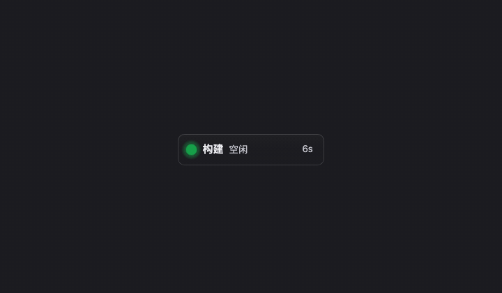
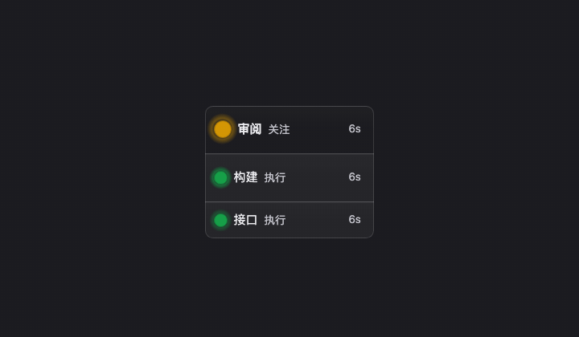
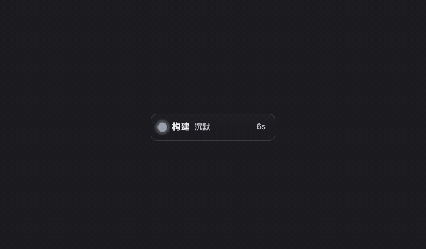
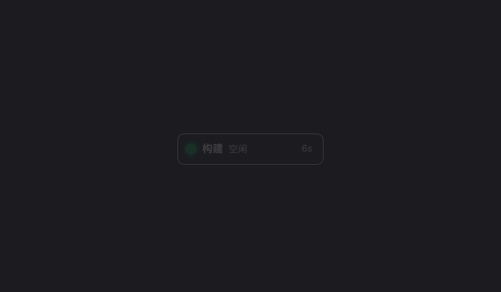
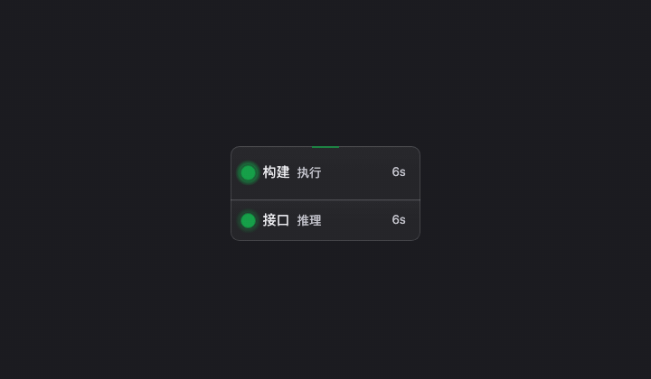
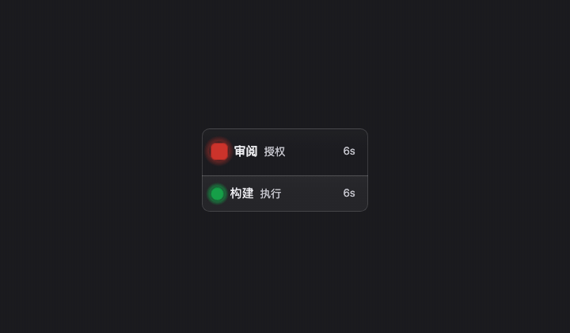
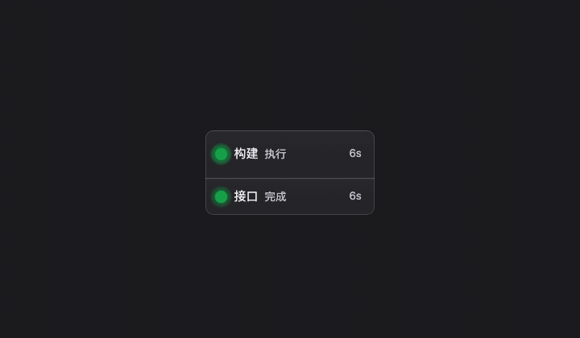
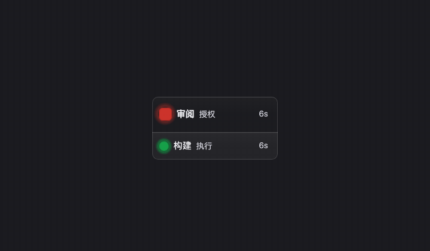

# SignalHub 实际使用场景

八段动图，按「什么时候会遇到这件事」组织，而不是按设置项排列。每段下面列出动图里**依次出现的画面**，以及在真机上它对应什么操作、去哪儿调。

> [English README](../README.en.md) · [中文 README](../README.md)

## 先说清楚：这些画面是什么

动图**不是录屏，也不是示意图**。它们是从 `npm run build` 产出的 `dist/` 里，用无头浏览器逐帧渲染 `?window=demo` 得到的：画面里的状态牌、收件箱面板、圆环菜单分别是产品自己的 `SignalLamp`、`InboxWindow`、`LampMenu` 组件，颜色、闪烁周期、圆角方灯珠、分段规则、按钮禁用态全部来自 `state.css` / `lamp.css` / `inbox.css`。所以改了灯效或收件箱排版，重跑一次脚本，动图会跟着变 —— 不会像手绘素材那样悄悄和代码漂移。

有几处边界也必须说清，免得看的人误判：

- **数据是剧本。** 组名「构建 / 接口 / 审阅」、命令、留言、审批条数来自 `src/lib/demo.ts`，不连接任何智能体、不读本机状态、不发通知、不写历史。动图里状态的推进是演示页按步切换，不是有人在真的敲键盘。
- **深色底是演示页的舞台**（`#1b1b20`），不是壁纸。真实的灯是透明、置顶、可拖拽的悬浮窗，叠在你的桌面上；这里把它放进一块固定画框，是为了让八段动图尺寸一致。
- **演示页的标题、场景条、图注、播放控件在录图时移出了画面**，产品组件自己的 CSS 一个字没改。每一步之间通过点演示页自己的进度条切换，因此 CSS 呼吸动画在整段里是连续的，状态跃迁也是产品自己的行为。
- **没有画进来的东西**：系统通知、托盘菜单、右键菜单、真实窗口的置顶与拖动、浅色壁纸下的可读性、多机汇总、WLED 物理灯。这些要看真窗口。
- 动图里的中文来自界面语言；脚本把语言固定成中文，所以这套图配的是本文档。

改了外观或演示内容后重画：

```bash
npm run build && sh scripts/render-scenes.sh
sh scripts/render-scenes.sh --only inbox     # 只重画一段
```

镜头表（`SCENES` / `DEMO_REEL`）和每步停留时长都在 `scripts/render-scenes.mjs`。脚本会先核对镜头表里的步数与 `src/lib/demo.ts` 一致，不一致直接报错——加了场景却忘了同步图，比图悄悄少一段好发现。依赖只有本机 Chrome、PATH 上的 `ffmpeg` 和 Node 22。

README 顶部那张首图也是**同一套渲染**产出的，只是镜头表换了：它挑的是九种状态的灯效节奏（常亮 / 快闪 / 慢闪 / 平滑闪 / 频闪 / 跃迁脉冲 / 灰），不讲故事；下面这八段讲具体场景。

---

## 1. 一天的节奏 · 接上之后，灯怎么呼吸



**什么时候用得上**：第一次接好智能体，想确认「它到底有没有在干活」，又不想一直切回终端看。

动图依次是：① 空闲，绿灯常亮；② 你问了一句，开始推理，绿灯快闪；③ 三组同时执行，一块牌一组，最紧急的排最前；④ 审阅组在等你批准，红色、圆角方灯珠、平滑闪，旁边两颗绿灯不会把它顶掉；⑤ 批准之后那组自己恢复工作，红灯消失；⑥ 全部完成，绿灯闪一下；⑦ 牌被移除后，空状态写的是「刚完成 · 1 分钟前」，而不是「没有智能体上报」。

**在真机上**：这些都是上报方推来的状态，不需要你操作。优先级是 `红 > 黄 > 绿`；完成的牌默认 3 分钟后消失，时长可在设置里改。牌上的「已持续」按进入当前状态的时刻自己往前走。多组同时呼吸时节奏按组错开，只有需要你处理的三种状态才同步闪。

---

## 2. 有事要你 · 黄、红、出错怎么分



**什么时候用得上**：手上在做别的事，余光扫到灯变色，要判断「能不能等会儿再看」。

动图依次是：① 黄色闪一下——需要关注，没卡住，也不等你批什么；② 红、黄、绿同时在，从上往下就是处理顺序；③ 出错也是红色，但节奏是快而硬的频闪，和等授权的平滑闪不一样。

**在真机上**：三者的区别刻意只放在颜色与节奏里，牌上不多一个字。长时间没有新消息，出错 5 分钟、授权 10 分钟后会转灰——「不说话了」和「空闲」不是一回事，见下一段。

---

## 3. 它不说话了 · 灰不等于空闲



**什么时候用得上**：长任务跑完或智能体断线后，想确认「它是还在，还是我已经不知道它在不在」。

动图依次是：① 半小时没消息，转灰常亮；② 把灯珠形状换成「圆环」后，弧长就是距离被移除还剩多久，会一点点缩到消失；③ 环走完，牌消失，文案变成「没有智能体在上报」。

**在真机上**：空心圆环是「外观 → 基础」里的可选灯珠形状，实心点没有地方画进度。灰 = 有会话但不再说话，绿常亮 = 空闲待命；这两者如果都画成灰色，你会在最需要确认的那一刻判断错。

---

## 4. 收起来的样子 · 少占桌面，不等于关掉提醒



**什么时候用得上**：灯平时挂在屏幕边角，你只想在有事时被它拉回注意力。

动图依次是：① 安静模式下，空闲/静默/无上报时整块压到很淡，一有事就恢复分量；② 单击折叠，默认竖成一列裸点，三组聚合成一颗点，只要有一组在等你它就是红的；③ 完成时这颗点照样闪一下再落定。

**在真机上**：单击折叠是默认动作，可在「设置 → 行为 → 单击动作」改成打开收件箱或什么都不做。「外观 → 基础」里能换成横排，也能让每颗灯带上组名 / 序号 / 状态词；折叠窄板按实际文字收宽，长名省略号截断、悬停看全。安静模式压暗的是显示，不是把提醒关掉。

---

## 5. 用光说话 · 六个灯位各自回答一个是非题



**什么时候用得上**：不想让牌上再多一个字，又想让「置顶 / 静音 / 快过期 / 穿透中」这类事实在余光里可查。

动图依次是：① 上沿亮短刻线、下沿不亮——上下是两个独立灯位；② 上下各挑各的画法；③ 换成最显眼的「长刻」；④ 行尾竖排四格站定位置；⑤ 四条条件同时成立时四格都亮，条件不成立时那枚记号**整个消失**，不留暗点；⑥ 同一块板上两行状态不同，上沿只在「要你处理」时亮；⑦ 第 1 格那枚近白竖条是「点击穿透」，开着才画；⑧ 上沿按「达到指定状态 → 出错」触发，六行各判各的；⑨ 一键换成「霓虹」皮肤，配色、牌形、动效、六灯位一起换。

**在真机上**：六个槽（上、下、行尾四格）在「外观 → 边框光」里各有一行画法下拉；亮不亮由「行为」页的九档触发条件决定，外观管长什么样、行为管凭什么现在亮。触发不成立就根本不画，所以「没亮」就是「没这回事」。关于点击穿透：状态是否常驻可见由你选，退出通道在托盘菜单和全局快捷键——穿透时窗口收不到指针，**不要指望悬停提示**。

---

## 6. 收件箱与审批 · 灯只说有事，细节在面板里



**什么时候用得上**：灯红了，你得知道「到底要我批准什么」，并且在不适合放行的情况下不被一键按钮骗过去。

动图依次是：① 红灯指出哪一组在等你，命令不摊在桌面上；② 打开面板，「需要你 / 运行中 / 刚刚完成 / 空闲沉默」四段，最该处理的总在最上面；③ 一条被截断的命令，「允许」是灰的、只能拒绝，另一条完整命令才给一键放行；④ 顶上「你离开的 24 分钟」把期间发生的事压成一句；⑤ 右键「推迟 15 分钟」后牌退成灰、停闪、显示倒计时；⑥ 处理完是明确的空态，「去接入」和「看演示」两个出口还在。

**在真机上**：长按灯呼出圆环 → 收件箱，或从托盘打开。面板走的是真实的 `buildInbox()` 分段。推迟只改变催促强度，底层状态一字不改，再点一次取消；到点会自动恢复。命令看不全就不给放行，这是刻意的——危险命令还会多一条红横幅。

---

## 7. Call Me 留言 · 有人找你，但不是「有事要你办」



**什么时候用得上**：人不在电脑前，外面的智能体想留一句话；回来之后想知道「刚才有人找我吗」。

动图依次是：① 灯还是绿的——留言走另一条通道，不占状态灯、不塞待办、不弹通知；② 同一个面板第二个页签上挂着一个红点未读数；③ 每条留言一行，蓝点是未读，名字是链接来源而不是智能体自报的名字；④ 展开一条看全文、出处和「打开出处」；⑤ 空态会写明原因，这里演示的是「还没配服务器」而不是「没有留言」。

**在真机上**：展开一条即标为已读，不用再点确认。四种空态各有各的原因——说错原因会让人跑去修一个根本没坏的东西。收件箱回答「有没有事要我做」，留言回答「刚才有人找我吗」，两件事平级所以做成两个页签。

---

## 8. 灯上的手势 · 三种手势，一个圆环



**什么时候用得上**：想折叠、想挪位置、想打开面板或设置，但不想在设置里翻菜单。

动图依次是：① 常态的两行牌；② 按住约半秒呼出圆环，从上顺时针是收件箱 / 设置 / 暂停 / 退出，中心那颗始终是此刻的灯；③ 暂停之后同一枚位置写成「继续」、图标一起换；④ 收起，回到折叠态的一列灯，照样按状态闪。

**在真机上**：单击折叠／再点展开，长按约 480ms 出圆环，按住拖动把灯挪到桌面别处——移动超过几个像素就算拖拽，不会误触成菜单。方向键或数字键 1–4 能直达圆环四项，Esc 收起；退出这种不可逆动作单独用警示色。圆环读的是当前状态，不是一张固定图。

---

## 想自己看一遍的话

不用装、也不用接智能体：浏览器里打开打包后的 `?window=demo` 就是同一段演示，可以暂停、单步、重播；装好之后在「设置 → 演示」页里也能看，只是画框小一档。`?demo=inbox&step=3` 这样的深链会直接停到某一帧，方便核对某个具体画面。

演示页用的是剧本数据，所以**它不会碰任何真实状态**：不发 IPC、不写剪贴板、不抢焦点、不改配置。真正想验证透明窗口、置顶、拖拽、浅色壁纸下的可读性、以及系统通知，仍然要跑 `npm run tauri dev`。
